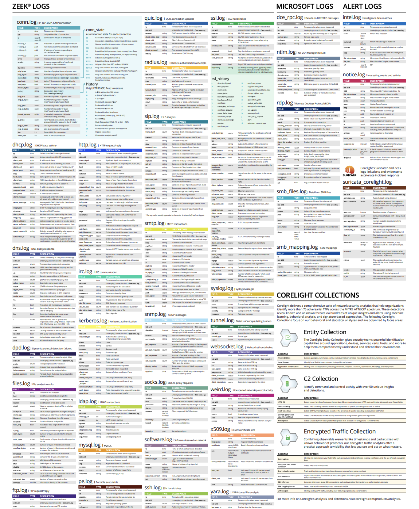

# ТЕОРЕТИКО-МЕТОДИЧЕСКИЕ ОСНОВЫ ПРОЕКТИРОВАНИЯ СИСТЕМЫ ЗАЩИТЫ ОТ ВРЕДОНОСНОЙ СЕТЕВОЙ АКТИВНОСТИ С ИСПОЛЬЗОВАНИЕМ ПОВЕДЕНЧЕСКОГО ПРОФИЛИРОВАНИЯ

## Анализ актуальных векторов сетевых атак

Несмотря на совершенствование средств защиты информации, именно конечный пользователь является главной целью злоумышленников. Ввиду роста использования российскими пользователями инструментов для организации защищенного доступа [@kommersant_vpn], прослеживается увеличение числа инцидентов информационной безопасности. Анализ актуальных векторов сетевых атак демонстрирует, что злоумышленники стали больше эксплуатировать доверие и техническую неосведомленность пользователей.

По данным компании Positive Technologies, с июля 2024-го по сентябрь 2025 года на долю России пришлось от 14% до 16% всех успешных кибератак в мире [@pt_threats_2026]. На рисунке ниже представлена динамика успешных кибератак на организации и частных лиц в России (@fig-cyber-dynamics).

```{r}
#| label: fig-cyber-dynamics
#| fig-cap: "Динамика успешных кибератак"
#| echo: false
#| message: false
#| warning: false
#| fig-align: "center"

library(ggplot2)
library(readr)
library(dplyr)

df <- read_csv("data/cyberattacks.csv", show_col_types = FALSE)

df$target <- factor(df$target, levels = c("Частные лица", "Организации"))

ggplot(df, aes(x = quarter, y = count, fill = target)) +
  geom_col(position = "stack", width = 0.6) +
  geom_text(aes(label = count), position = position_stack(vjust = 0.5), color = "white", size = 3.5) +
  facet_grid(~ year, switch = "x", scales = "free_x", space = "free_x") +
  scale_fill_manual(values = c("Организации" = "#e31a1c", "Частные лица" = "#f49b9b")) +
  labs(x = NULL, y = NULL, fill = NULL) +
  theme(
    legend.position = "bottom",
    strip.placement = "outside",
    strip.background = element_blank(),
    strip.text = element_text(size = 14, face = "bold", color = "#a6b5c7"),
    panel.grid.major.x = element_blank(),
    panel.grid.minor = element_blank()
  )
```

Исходя из данной динамики, можно сделать следующий вывод относительно частных лиц: наблюдается заметное увеличение числа атак на пользователей. Если в первой половине 2024 года фиксировалось 18-23 инцидента за квартал, то данный показатель вырос до 31-45 инцидентов в квартал за тот же временной промежуток в 2025 году, что на 53% больше.

Анализ гистограммы успешных атак относительно методов (@fig-attack-methods) показывает, что среди векторов воздействия преобладает социальная инженерия, на которую приходится 96%, однако стоит обратить внимание на второй по величине метод -- использование вредоносного программного обеспечения. Исходя из данных наблюдений, складывается следующий вывод -- злоумышленники при воздействии на частных лиц делают акцент на человеческом факторе и доверчивости пользователей.

```{r}
#| label: fig-attack-methods
#| fig-cap: "Методы кибератак на организации и частные лица"
#| echo: false
#| message: false
#| warning: false
#| fig-align: "center"
#| fig-height: 6
#| fig-width: 9

library(ggplot2)
library(readr)
library(dplyr)
library(stringr)

df <- read_csv("data/attack_methods.csv", show_col_types = FALSE)

df$method <- str_wrap(df$method, width = 35)

category_order <- rev(unique(df$method))
df$method <- factor(df$method, levels = category_order)

df$target <- factor(df$target, levels = c("Частные лица", "Организации"))

ggplot(df, aes(x = method, y = value, fill = target)) +
  geom_col(position = position_dodge(width = 0.7), width = 0.6) +
  
  geom_label(
    aes(label = label),
    position = position_dodge(width = 0.7),
    hjust = -0.15,
    fill = "white",
    color = "#333333",
    label.size = 0,
    fontface = "bold",
    size = 3.5,
    na.rm = TRUE
  ) +
  
  scale_fill_manual(values = c("Организации" = "#ff0000", "Частные лица" = "#ffafaf")) +
  
  scale_y_continuous(
    limits = c(0, 105),
    breaks = seq(0, 100, 10),
    labels = function(x) paste0(x, "%")
  ) +
  coord_flip() +
  labs(x = NULL, y = NULL, fill = NULL) +
  theme_minimal() +
  theme(
    panel.background = element_rect(fill = "#f0f2f5", color = NA),
    plot.background = element_rect(fill = "#ffffff", color = NA),
    
    panel.grid.major.y = element_blank(),
    panel.grid.major.x = element_line(color = "#e0e0e0", linetype = "dashed"),
    panel.grid.minor = element_blank(),
    
    legend.position = "bottom",
    legend.title = element_blank(),
    
    axis.text.y = element_text(size = 10, color = "#555555"),
    axis.text.x = element_text(size = 9, color = "#777777")
  )
```

Рассматривая распределение долей успешных атак с использованием вредоносного программного обеспечения относительно частных лиц (@fig-malware-types), можно заметить преобладание следующих типов: вредоносное программное обеспечение для удаленного управления, шпионское программное обеспечение, банковский троян. Данная статистика свидетельствует о том, что злоумышленники стремятся к максимально скрытному присутствию на устройстве жертвы, незаметно для пользователя крадут его личную информацию и пересылают ее на удаленный сервер для дальнейшей продажи.

```{r}
#| label: fig-malware-types
#| fig-cap: "Типы используемого ВПО в атаках на организации и частных лиц"
#| echo: false
#| message: false
#| warning: false
#| fig-align: "center"
#| fig-height: 6
#| fig-width: 9

library(ggplot2)
library(readr)
library(dplyr)
library(stringr)

df_malware <- read_csv("data/malware_types.csv", show_col_types = FALSE)

df_malware$method <- str_wrap(df_malware$method, width = 35)

category_order_malware <- rev(unique(df_malware$method))
df_malware$method <- factor(df_malware$method, levels = category_order_malware)

df_malware$target <- factor(df_malware$target, levels = c("Частные лица", "Организации"))

ggplot(df_malware, aes(x = method, y = value, fill = target)) +
  geom_col(position = position_dodge(width = 0.7), width = 0.6) +
  
  geom_label(
    aes(label = label),
    position = position_dodge(width = 0.7),
    hjust = -0.15,
    fill = "white",
    color = "#333333",
    label.size = 0,
    fontface = "bold",
    size = 3.5,
    na.rm = TRUE
  ) +
  
  scale_fill_manual(values = c("Организации" = "#ff0000", "Частные лица" = "#ffafaf")) +
  
  scale_y_continuous(
    limits = c(0, 60),              
    breaks = seq(0, 55, 5),
    labels = function(x) paste0(x, "%")
  ) +
  coord_flip() +
  labs(x = NULL, y = NULL, fill = NULL) +
  theme_minimal() +
  theme(
    panel.background = element_rect(fill = "#f0f2f5", color = NA),
    plot.background = element_rect(fill = "#ffffff", color = NA),
    
    panel.grid.major.y = element_blank(),
    panel.grid.major.x = element_line(color = "#e0e0e0", linetype = "dashed"),
    panel.grid.minor = element_blank(),
    
    legend.position = "bottom",
    legend.title = element_blank(),
    
    axis.text.y = element_text(size = 10, color = "#555555"),
    axis.text.x = element_text(size = 9, color = "#777777")
  )
```

**Вывод по параграфу 1.1**

Подводя итог анализу актуальных векторов кибератак, можно сделать следующий вывод относительно частных лиц: имеется тенденция к росту числа инцидентов. При атаке на пользователя злоумышленники делают акцент на человеческом факторе и технической неосведомленности граждан. Преступники стремятся к максимально незаметному присутствию на устройстве жертвы, об этом говорят преобладающие типы вредоносного программного обеспечения, а именно инструменты для удаленного управления, шпионские приложения и банковские трояны.

## Анализ решений по защите пользователей от подозрительной сетевой активности

Для противодействия описанным векторам атак и защиты конечных пользователей от скрытого вредоносного воздействия применяются различные системы защиты.
Архитектуру системы мониторинга сетевой активности можно представить в виде компонентов:

- Агент - установленная на отслеживаемых хостах программа, которая собирает данные о сетевой активности и отправляет их на сервер для анализа;

- Сервер - центральный компонент системы, выполняющий анализ данных, полученных от агентов;

- База данных - централизованная хранилище, которое накапливает собранные данные о состоянии сети;

- Визуализация и управление - интерфейс, который прдоставляет пользователям доступ к информации о мониторинге и управлению настройками, чаще всего представлен в виде веб-приложения.

В процессе мониторинга сетевой активности допустимо выделить ключевые уровни контроля, зависящие от точки перехвата пакетов:

- Уровень конечной точки: мониторинг трафика и активности программ осуществялется локально на устройстве клиента;

- Уровень внутренней сети: трафик отслеживается в ммоент его прохождения через коммутатор, который связывает устройства внутри периметра;

- Уровень сетевого периметра: анализ осуществляется на границе между корпоративной инфраструктурой и Интернетом.

С учетом выделенных уровней перехвата пакетов, на сегодняшний день имеется большой выбор программных средств и архитектурных подходов, направленных на мониторинг сетевой активности пользователей.

### Мобильные анализаторы трафика

Данные программные решения устанавливаются на смартфон клиента. Из-за соображений безопасности приложения не имеют прямого доступа к сетевому трафику телефона. Для решения проблемы подобные программные продукты используют встроенный системный механизм создания виртуальной частной сети, другими словами, мобильные приложения создают на устройстве виртуальный сетевой интерфейс и перенаправляют все сетевые пакеты через себя, то есть анализ метаданных соединений производится непосредственно в памяти устройства. Примерами такого типа приложений могут служить: GlassWire и PCAPdroid.

Главным преимуществом решения является высокая степень конфиденциальности, поскольку данные не покидают пределы устройства и пользователю не требуется доверять свой трафик сторонним серверам.

У такого подхода имеется несколько существенных недостатков. Так как выполнение анализа пакетов, сверка метаданных с индикаторами компрометации из баз данных осуществляется непосредственно на смартфоне, это создает избыточную нагрузку на процессор и оперативную память мобильного устройства, что вызывает заторможенность в работе и повышенный расход энергии аккумулятора. Также стоит отметить, что в современных устройствах имеются встроенные механизмы операционной системы, которые направлены на оптимизацию заряда батареи и могут принудительно выгружать фоновую службу анализатора из памяти.

### Облачные сервисы фильтрации и мониторинга на уровне DNS

При использовании данного типа реализации нет необходимости в установке какого-либо стороннего программного обеспечения на устройство клиента. Пользователь прописывает в настройках мобильного телефона адрес защищенного DNS-сервера, в свою очередь, сервис сверяет все доменные имена, которые запрашивает устройство, с индикаторами компрометации из баз данных. Примерами таких сервисов могут служить: AdGuard DNS и NextDNS.

Ключевым преимуществом такого метода является простота внедрения и нелувое влияние на производительность смартфона, так как все операции по выявлению и блокировке вредоносных узлов выполняются на далненных серверах.

Данный подход имеет ряд проблем. Стоит обратить внимание на отсутствие возможности глубокого анализа содержимого сетевых пакетов, так как система не имеет доступа к полным URL-адресам, путям запросов и передаваемому контенту. Также необходимо учитывать наличие единой точки отказа -- при сбоях в сети провайдера DNS пользователь может полностью потерять доступ к интернету.

### DNS-серверы для локальных сетей

Данный подход обеспечивает защиту клиента путем развертывания сервиса фильтрации непосредственно внутри локальной сети пользователя. Для реализации необходимо установить специализированное программное обеспечение на постоянно включенное устройство, которому в локальной сети назначается статический IP-адрес.

При стандартной конфигурации маршрутизатор автоматически передает подключаемым устройствам адрес DNS-сервера интернет-провайдера или свой собственный. После внедрения сетевого фильтра описанный выше принцип работы изменяется -- всем клиентам в качестве основного DNS-сервера назначается внутренний IP-адрес развернутого сетевого фильтра. В результате все устройства сети перестают обращаться к DNS-серверам провайдера напрямую и направляют трафик через общий узел, который отсекает рекламу и известные вредоносные сайты. Самым популярным программным решением, основанным на представленном подходе, является Pi-hole.

Преимуществом такого архитектурного метода выступает безагентная защита всех устройств сети одновременно. Это позволяет эффективно защищать IoT-устройства, так как на большую часть такого оборудования технически невозможно установить классическое программное обеспечение для защиты.

Рассмотренное решение обладает рядом ограничений. Слабым местом такого архитектурного метода является зависимость от одного локального сервера. Если устройство, на котором установлено фильтрующее приложение, выключится, зависнет или получит другой IP-адрес, клиенты могут потерять доступ к сайтам. Помимо этого, стоит обратить внимание на факт функционирования защиты только внутри домашнего периметра, то есть при отключении смартфона от домашней сети и переходе на мобильную передачу данных, устройство выходит из локальной сети, следовательно, перестает защищаться фильтром.

### Мобильные средства защиты от угроз

Данный класс приложений фокусируется на комплексной защите устройства пользователя, они позволяют выявлять вредоносные программные решения, пресекать переход клиента на фишинговый ресурс и контролировать целостность системы. Примером такого программного решения может служить Kaspersky Endpoint Security. Работа подобных решений строится на комбинации трех уровней проверки:

- Анализ приложений и файлов. Средство защиты сканирует файлы в хранилище устройства, вычисляет хеш-суммы и сверяет их с базами сигнатур известных вредоносных программных обеспечений. Также могут дополнительно оценивать набор разрешений, которые запрашивает мобильное приложение;

- Оценка уязвимостей устройства. Решение проверяет конфигурацию операционной системы, например, включенный режим отладки по USB или разрешение на установку пакетов из неизвестных источников;

- Проверка ссылок и беспроводных сетей. Для реализации защиты от фишинга и вредоносных сайтов данные программные решения используют системные службы специальных возможностей, помимо этого анализируются параметры беспроводных сетей на подозрительные настройки;

Ключевым преимуществом применения данного инструмента является тщательная проверка файлов и внутренних настроек устройства. Это помогает вовремя находить уже известные угрозы, предотвращать эксплуатацию системных уязвимостей и блокировать установку вредоносного программного обеспечения.

Использование подобных мобильных средств защиты имеет ряд ограничений. Из-за строгой изоляции приложений данные средства проверяют сами файлы на смартфоне, сверяя контрольные суммы по базам данных для поиска совпадений, но не способны полноценно анализировать сетевой трафик других программ. Возможна ситуация, при которой на устройство пользователя было установлено вредоносное приложение, зафиксированное антивирусом как легитимное. Исходя из вышеуказанной проблемы изоляции -- средство защиты не сможет заметить факт передачи таким программным обеспечением личных данных на удаленный сервер злоумышленника. Также стоит обратить внимание на необходимость постоянной фоновой активности такого типа решений -- из-за чего происходит нагрузка на процессор.

### Веб-браузеры со встроенной фильтрацией

Средства защиты такого вида представляют собой приложения для просмотра веб-сайтов, в архитектуру которых интегрированы инструменты блокировки подозрительных ресурсов и рекламы. Примерами таких решений могут выступать: Brave Browser и DuckDuckGo Privacy Browser.

При открытии любого ресурса браузер предварительно сверяет URL-адрес с базами вредоносных сайтов, переводит соединение на протокол HTTPS, блокирует выполнение сторонних скриптов. Также используется механизм песочниц, который изолирует каждую вкладку от операционной системы и друг от друга, то есть, если вредоносный код выполнится на веб-странице, он останется внутри вкладки и не сможет получить доступ к файлам на устройстве или к процессам операционной системы.

Ключевым преимуществом данного решения является использование технологии песочниц, которая строго изолирует каждую открытую вкладку друг от друга и от операционной системы устройства. Благодаря такой архитектуре, даже если вредоносный код будет успешно выполнен на скомпрометированной веб-странице, результат работы останется внутри конкретной вкладки и не сможет получить несанкционированный доступ к файловой системе смартфона.

Данный подход имеет ограничения. Подобный веб-браузер контролирует и фильтрует сетевой трафик исключительно внутри приложения и не влияет на работу остальных программ, то есть весь трафик, создаваемый этими приложениями, проходит мимо системы защиты, минуя фильтры.

В таблице ниже (@tbl-solutions-comparison) представлен сравнительный анализ рассмотренных архитектурных подходов.

| Подход | Примеры решений | Основные преимущества | Ключевые недостатки |
|:-----------------|:-----------------|:-----------------|:-----------------|
| **Мобильные анализаторы трафика** | GlassWire, PCAPdroid | Анализ соединений непосредственно на устройстве через локальный VPN-интерфейс. | Высокая нагрузка на ЦП, ОЗУ, батарею, риск принудительной выгрузки службы операционной системой. |
| **Облачные DNS-сервисы** | AdGuard DNS, NextDNS | Отсутствие необходимости устанавливать стороннее ПО на смартфон пользователя. | Невозможность глубокого анализа пакетов, наличие единой точки отказа на стороне провайдера. |
| **Локальные DNS-серверы** | Pi-hole | Централизованная фильтрация вредоносного трафика для всех устройств в пределах сети. | Защита не функционирует при выходе из защищенного периметра, зависимость от локального узла. |
| **Мобильные средства защиты от угроз** | Kaspersky Endpoint Security | Комплексный контроль: сканирование файлов, проверка уязвимостей ОС и беспроводных сетей. | Невозможность полноценного анализа трафика других программ из-за строгой изоляции приложений, постоянная фоновая нагрузка. |
| **Браузеры со встроенной фильтрацией** | Brave, DuckDuckGo | Встроенный механизм песочниц, изоляция вкладок, принудительное использование HTTPS. | Мониторинг и фильтрация трафика ограничиваются исключительно рамками самого приложения-браузера. |

: Сравнительный анализ решений по защите от подозрительной сетевой активности {#tbl-solutions-comparison}

**Вывод по параграфу 1.2**

Подводя итог анализу существующих решений по защите пользователей от подозрительной сетевой активности, можно сделать вывод о том, что ни один из рассмотренных подходов не обеспечивает полноценного и удобного мониторинга всего трафика устройства. Решения, которые устанавливаются непосредственно на смартфон, создают высокую нагрузку на процессор и увеличивают расход заряда аккумулятора телефона, помимо этого их работа ограничивается операционной системой путем выгрузки средства защиты из фона и строгой изоляцией приложений. Веб-браузеры со встроенным фильтром обрабатывают соединения исключительно внутри себя, локальные серверы перестают защищать смартфон при выходе за пределы домашней сети, а облачные DNS-сервисы не способны выполнять глубокий анализ пакетов.

## Ключевые методы и технологии обнаружения вредоносной активности в трафике
Выбор архитектуры определяет только место перехвата трафика, однако не решает задачу поиска угроз. Поэтому необходимо определить наиболее эффективный метод для обнаружения вредоносной активности в полученных сетевых пакетах.
Обнаружение вредоносной сетевой активности требует применения комплекса технологий, так как ни один отдельной взятый инструмент не обеспечивает абсолютной защиты. Выбор конкретного метода или их комбинации зависит от множества факторов, например, архитектуры сети, вычислительных мощностей сервера. В данном разделе рассматриваются базовые принципы работы этих методов, их ключевые преимущества и ограничения.

### Глубокий анализ пакетов

Метод позволяет заглядывать внутрь сетевых пакетов и анализаровать их содержимое до уровня приложений, другими словами, если злоумышленник передает файлы по HTTP, глубокий анализ пакетов может извлечь эти файлы и отправить на анализ в другую систему. Ограничением данного подхода является зашифрованный трафик, пакеты которого невозможно проанализировать.

### Потоковый анализ

Вместо анализа каждого пакета по отдельности система агрегирует информацию о всем потоке целиком. Он показывает, какие узлы взаимодействуют между собой, как меняется распределение нагрузки и в каких сегментах сети растет активность. Анализ такого типа показывает себя эффективно для обнаружения аномалий в объеме, например, резкий рост исходящего трафика с конкретного хоста.

### Анализ на основе сигнатур

Принцип работы подхода заключается в сопоставлении параметров и содержимого сетевых пакетов с заранее сформированной базой данных известных атак и уязвимостей. При обнаружении точного совпадения параметров трафика с индикаторами система фиксирует инцидент. Ключевым преимуществом данного метода выступает минимальный уровень ложноположительных срабатываний при обнаружении известных векторов атак. Стоит отметить существенный недостаток такого подхода -- невозможность выявления ранее неизвестных угроз до момента обновления базы данных. Также можно выделить подтип сигнатурного анализа -- применение черных и белых списков. Данный подход позволяет администраторам сети самостоятельно формировать и настраивать правила фильтрации с учетом специфики инфраструктуры или внутренних регламентов организации. Несмотря на простоту реализации механизма, он имеет существенный недостаток -- необходимость постоянной актуализации правил при каждом изменении в сетевой топологии. Помимо этого, такой подход оказывается неэффективным, если злоумышленник скомпрометирует узел, который уже находится в белом списке.

### Применение песочниц

Технология анализа подозрительных объектов в изолированной среде. Если система мониторинга сетевого трафика выявляет подозрительный файл, она может отпраавить этот элемент в песочницу для проверки - там файл выполняется в виртуальной среде. По поведению файла можно сделать вывод о вредоносности без использования сигнатур.

### Поведенческий анализ и машинное обучение

Суть данного метода заключается в сборе данных о трафике в безопасный период и построении профиля нормально поведения. Затем система в реальном времени сравнивает текущий трафик с созданной конфигурацией - любое отклонение фиксируется как подозрительное. При использовании методов машинного обучения с целью выявления аномалий в сетевом трафике устраняются некоторые ограничения и проблемы анализа на основе сигнатур, например, неспособность выявления ранее неизвестных угроз и зависимость от регулярного обновления баз данных индикаторов компрометации. Алгоритмы машинного обучения способны выявлять новые векторы атаки, адаптироваться к их постоянным изменениям и эффективно находить отклонения от нормального поведения [@ml_detect_threats_2026].

Имеются два основных метода обучения модели:

1)  Обучение с учителем -- это метод, который использует размеченные данные для обучения моделей. Для работы такого типа алгоритмов используются данные с заранее заданными метками и цель процедуры -- найти закономерности, которые позволят точно предсказывать эти индикаторы для новых данных [@ml_types]. Ключевым преимуществом применения такого подхода является высокая точность классификации при наличии качественно размеченных данных. Главный недостаток этого метода в контексте сетевой безопасности заключается в непрерывном видоизменении векторов атак, поэтому собрать абсолютно точную и актуальную базу данных для обучения практически невозможно.

2)  В обучении без учителя модель получает данные без меток, и ее задача заключается в самостоятельном выделении группы данных. Этот метод полезен, когда задача состоит в поиске неожиданных и скрытых закономерностей в большом объеме информации [@ml_types]. Однако у такого метода имеется недостаток -- текущий подход может создавать большой объем ложных срабатываний ввиду того, что любое отклонение от нормы может быть ошибочно зафиксировано как угроза.

Одним из методов обучения без учителя является алгоритм изолирующий лес. Метод строит ансамбль случайных бинарных деревьев, где данные рекурсивно делятся по случайным признакам и порогам. Подход эксплуатирует свойство аномалий: они находятся далеко от плотных областей распределения и требуют меньше операций для изоляции. Нормальные точки, расположенные в плотных областях, изолируются глубже в дереве, в свою очередь аномалии изолируются ближе к корню. На каждом шаге алгоритм случайно выбирает признак и порог между минимальным и максимальным значением этого признака в текущем подмножестве данных. Пространство делится на два региона, процесс повторяется рекурсивно для каждого региона до достижения условия остановки.

На рисунке ниже показана визуализация принципа изоляции в изолирующем лесу (@fig-isolation-forest). Левая панель демонстрирует изоляцию аномалии одним разбиением, правая панель показывает необходимость множественных разбиений для изоляции нормальной точки внутри плотного кластера.

```{r}
#| label: fig-isolation-forest
#| fig-cap: "Принцип изоляции аномалий и нормальных точек в алгоритме Isolation Forest"
#| echo: false
#| message: false
#| warning: false
#| fig-width: 12
#| fig-height: 5

library(ggplot2)
library(readr)
library(patchwork)

df <- read_csv("data/isolation_forest.csv", show_col_types = FALSE)

df_normal <- subset(df, type %in% c("normal", "target"))
df_anomaly <- subset(df, type == "anomaly")
df_target <- subset(df, type == "target")

base_theme <- theme_bw() +
  theme(
    plot.title = element_text(face = "bold", size = 12, hjust = 0.5),
    panel.grid.minor = element_blank(),
    panel.grid.major = element_line(color = "#f0f0f0")
  )

p1 <- ggplot() +
  annotate("rect", xmin = 0.5, xmax = 4.2, ymin = 0.5, ymax = 5.5, fill = "#e6e6ff", alpha = 0.7) +
  annotate("rect", xmin = 4.2, xmax = 6.5, ymin = 0.5, ymax = 5.5, fill = "#ffe6e6", alpha = 0.7) +
  
  geom_point(data = df_normal, aes(x = x1, y = x2), color = "black", alpha = 0.5, size = 2) +
  geom_point(data = df_anomaly, aes(x = x1, y = x2), shape = 4, size = 5, color = "#cc0000", stroke = 2) +
  
  geom_vline(xintercept = 4.2, color = "blue", linetype = "dashed", linewidth = 1) +
  
  annotate("text", x = 2.3, y = 0.8, label = "Регион с кластером", color = "blue", fontface = "bold") +
  annotate("text", x = 5.3, y = 0.8, label = "Регион с аномалией\n(изолирована)", color = "red", fontface = "bold") +
  annotate("text", x = 4.6, y = 4.6, label = "x1 = 4.2", color = "blue") +
  
  coord_cartesian(xlim = c(0.5, 6.5), ylim = c(0.5, 5.5), expand = FALSE) +
  labs(title = "Шаг 1: Изоляция аномалии (path length = 1)", x = "Признак x1", y = "Признак x2") +
  base_theme

p2 <- ggplot() +
  geom_point(data = df_normal, aes(x = x1, y = x2), color = "black", alpha = 0.5, size = 2) +
  geom_point(data = df_anomaly, aes(x = x1, y = x2), shape = 4, size = 5, color = "#cc0000", stroke = 2) +
  
  geom_point(data = df_target, aes(x = x1, y = x2), shape = 16, size = 5, color = "#008000") +
  geom_rect(aes(xmin = 1.4, xmax = 1.8, ymin = 1.6, ymax = 2.0), fill = NA, color = "#008000", linewidth = 1) +
  
  geom_vline(xintercept = 2.5, color = "blue", linetype = "dashed") +
  geom_vline(xintercept = 1.9, color = "purple", linetype = "dashed") +
  geom_hline(yintercept = 2.3, color = "orange", linetype = "dashed") +
  geom_hline(yintercept = 1.8, color = "brown", linetype = "dashed") +

  annotate("label", x = 4.5, y = 4.6, label = "Требуется 4+ разбиений", 
           fill = "#fff8dc", color = "black", fontface = "bold", label.size = 0.5) +
  
  coord_cartesian(xlim = c(0.5, 6.5), ylim = c(0.5, 5.5), expand = FALSE) +
  labs(title = "Шаг 2-5: Изоляция нормальной точки (path length > 4)", x = "Признак x1", y = "Признак x2") +
  base_theme

p1 + p2
```

Ниже представлена таблица для сравнения методов, которые были упомянуты ранее (@tbl-analys-methods).

| Метод | Принцип работы | Ключевые преимущества | Основные ограничения |
|:-----------------|:-----------------|:-----------------|:-----------------|
| **Глубокий анализ пакетов (DPI)** | Детальная инспекция содержимого пакетов до уровня приложений | Глубокая видимость передаваемых данных, высокая точность | Слепота к зашифрованному трафику (HTTPS/TLS) |
| **Потоковый анализ** | Агрегация метаданных о сетевых соединениях | Низкая нагрузка на сеть, выявление аномалий в объеме трафика | Отсутствие анализа полезной нагрузки |
| **Сигнатурный анализ** | Поиск точных совпадений с базой известных индикаторов угроз | Минимальное число ложных срабатываний, высокая скорость | Неспособность выявлять атаки нулевого дня |
| **Песочницы** | Запуск подозрительных объектов в изолированной среде | Точное определение вредоносности по реальному поведению | Задержка в анализе, высокие требования к ресурсам |
| **Машинное обучение** | Построение профиля нормального поведения и поиск отклонений | Выявление скрытых зависимостей и ранее неизвестных угроз | Риск ложных срабатываний |

: Сравнительный анализ методов обнаружения подозрительной активности {#tbl-analys-methods}

**Вывод по параграфу 1.3**

Проведенный анализ методов обнаружения вредоносной активности в сетевом трафике показывает, что ни одна из технологий не обеспечивает абсолютное выявление аномалий. Глубокий анализ пакетов и сигнатурный метод, гарантируют высокую точность выявления известных угроз, однако уязвимы перед зашифрованным трафиком и атаками нулевого дня. Внедрение алгоритмов машинного обучения и поведенческого анализа позволяет компенсировать эти ограничения за счет выявления скрытых закономерностей и адаптации к новым векторам атак, однако остается риск ложных срабатываний.

## Централизованный сбор и извлечение признаков сетевого трафика
Надежность рассмотренных методов машинного обучения напрямую зависит от качества и полносты обрабатывемой информации. Для корректной работы механизма обнаружения вторжений на основе машинного обучения необходимы данные о сетевой активности, на которых будет обучаться модель. Существуют два подхода к перехвату трафика: установка специализированного агента и использование технологии виртуальной частной сети для маршрутизации трафика на выделенный сервер.

Разработка агента является трудоемкой задачей, требующей адаптации под различные операционные системы. Использование VPN-конфигурации позволяет направить весь пользовательский трафик через выделенный сетевой интерфейс сервера, в частности применение OpenVPN гарантирует изоляцию трафика клиента от сервера, что позволяет системе анализа получить полную информацию о метаданных сетевых пакетов пользователей.

В качестве инструмента для извлечения метаданных из сетевого трафика рассматривается Zeek -- программный комплекс с открытым исходным кодом для анализа трафика в сети [@zeek_about]. К основным функциям и особенностям технологии можно отнести:

- Генерация большого набора логов;

- Обнаружение различных видов атак и аномалий в сети;

- Помимо функциональности «из коробки», Zeek представляет собой полностью настраиваемую и расширяемую платформу для анализа трафика. Пользователям предоставляется предметно-ориентированный язык сценариев для решения произвольных аналитических задач;

Каждый лог-файл, генерируемый инструментом, содержит в себе определенную сетевую активность: HTTP-сессии, DNS-запросы, TLS-соединение, информацию о сертификатах. На рисунке ниже представлен полный перечень возможных журналов событий, которые способна генерировать данная платформа (@fig-zeek-logs).

{#fig-zeek-logs fig-align="center" width="100%"}

В системе мониторинга сетевой активности Zeek предусмотрена возможность использования пользовательских плагинов -- специализированных программных компонентов, которые расширяют базовый функционал анализатора сетевой активности. В качестве наиболее популярных плагинов можно выделить:

- Geoip-conn -- данное расширение позволяет дополнить журнал событий conn.log информацией о геолокации трафика (код страны, область, город, широта, долгота)

- Zeek-intelligence-feeds -- функционал данного плагина заключается в автоматическом сборе данных об индикаторах компрометации из публичных источников. Встроенный в Zeek анализатор проверяет каждый сетевой пакет на соответствие собранным данным. При обнаружении совпадения соответствующее событие фиксируется в специализированном лог-файле intel.log.

**Вывод по параграфу 1.4**

Таким образом, используя OpenVPN и Zeek можно сформировать конвейер данных: VPN обеспечивает прозрачный перехват пользовательского трафика, а расширяемая архитектура Zeek преобразует сырые пакеты в структурированные лог-файлы, которые можно использовать для анализа и обучения модели машинного обучения для проведения поведенческого анализа.

**Выводы по первой главе**

Таким образом, материалы исследовательского раздела формируют целостную теоретическую и методическую базу для дальнейшей разработки. В разделе рассмотрены актуальные векторы сетевых атак, решения по защите пользователей от подозрительной сетевой активности, традиционные подходы к выявлению аномалий, применение алгоритмов машинного обучения для поиска угроз, централизованный сбор и извлечение признаков сетевого трафика. Полученные выводы используются далее при построении специального раздела, где выполняется разработка многоуровневой системы защиты пользователей от вредоносной сетевой активности с использованием поведенческого профилирования.