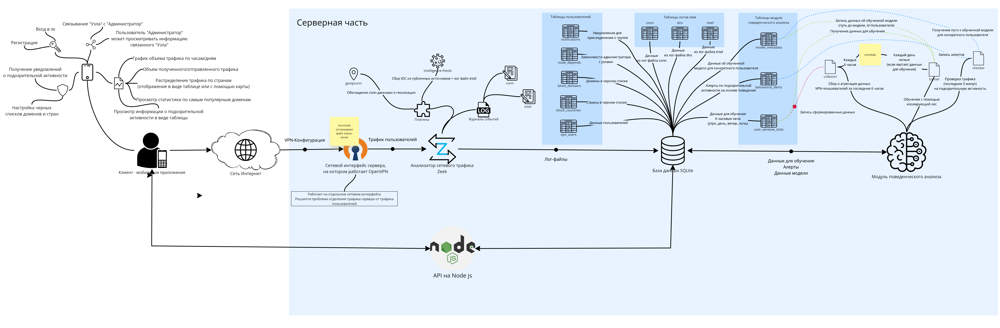

# РАЗРАБОТКА АРХИТЕКТУРЫ СИСТЕМЫ
Разрабатываемая система представляет собой программный комплекс, состоящий из серверной части и клиентской, которая реализована в виде мобильного приложения. На рисунке ниже показана ее схема (@fig-system-scheme).

{#fig-system-scheme fig-align="center" width="100%"}

## Серверная архитектура
Серверная часть выполняет полный цикл обработки данных - от захвата трафика до взаимодействия с мобильным клиентом. Логически данную область системы можно разделить на несколько компонентов:

1. Сетевой интерфейс, на котором расположен OpenVPN - необходимо для обособления сетевого трафика пользователей от серверного;
2. Анализатор Zeek - данный компонент служит инструментом для формирования журналов событий с информацией о сетевых соединениях подключенных пользователей. Также средство предоставляет плагины, которые позволяют обогащать собранную информацию сведениями об индикаторах компрометации и геолокации Ip-адресов;
3. База данных SQLite - средство для хранения информации;
4. REST API - реализует взаимодействие между клиентом и сервером;
5. Модуль поведенческого профилирования - компонент, реализующий поведенческий анализ;

### Сбор данных о сетевых подключениях
Ранее было упомянуто про техники сбора информации о сетевых подключениях: использование виртуальной частной сети и создание специализированного агента, который будет передавать данные о сетевой активности на удаленный сервер. При реализации данной архитектуры будет использоваться второй метод, это обусловлено сложностью разработки агента для различных операционных систем.
В качестве решения для создания частной виртуальной сети выбран инструмент OpenVPN. Данный выбор обоснован принципом работы программного решения, оно пропускает весь трафик через отдельный сетевой интерфейс, благодаря чему система анализа получает возможность просматривать весь трафик пользователей. Таким образом, Zeek отслеживает и записывает информацию о метаданных соединений, принадлежащих клиентам.

### Анализ сетевого трафика
Для сбора метаданных сетевого трафика используется инструмент Zeek. Архитектура средства разделена на два основных компонента. Первый компонент – это движок событий, который помогает разделить сетевой пакет на несколько высокоуровневых событий. Они отражают сетевую активность, т.е. они описывают то, что было замечено в сетевом пакете. Компонент включает в себя ряд подкомпонентов:

- Источники ввода;
- Анализ пакетов обрабатывает протоколы более низкого уровня, начиная с канального уровня;
- Анализ сессий проверяет протоколы прикладного уровня (HTTP, FTP и т.д.);
- Анализ файлов исследует содержимое файлов, передаваемых во время сессии

Вторым основным компонентом Zeek является интерпретатор сценариев, который выполняет набор обработчиков событий, написанных на скриптовом языке Zeek.
Далее описаны его возможности в контексте разрабатываемой системы.

#### Журналы и отчеты
Одним из главных преимуществ данной технологии является генерация большого набора журналов событий. Из огромного числа лог-файлов можно выделить следующие:

- conn.log - является одним из наиболее важных источников информации о сетевом трафике, создаваемых Zeek. В нем фиксируется каждое соединение, которое проходит через систему мониторинга. Журнал предоставляет базовую информация о сетевых потоках на транспортном и сетевом уровнях. Каждая запись содержит следующие ключевые метрики: универсальный идентификатор сессии, который позволяет связать запись в conn.log с информацией из других журналов; ip-адреса и порты участников текущего взаимодействия; длительность соединения; количество байт, которые были переданы или получены; состояние соединения;
- dns.log - журнал, который фиксирует все DNS-запросы и ответы.

#### Расширение функционала
В системе мониторинга сетевой активности Zeek предусмотрена возможность использования пользовательских плагинов, позволяющие расширять базовый функционал анализатора.
Для определения геолокации IP-адресов возможно применение API сторонних сервисов, например, VirusTotal, однако большинство подобных платформ предоставляют доступ на платной основе. Применяя расширение geoip-conn можно дополнить журнал событий conn.log следующей информацией:

- Код страны
- Регион
- Город
- Широта
- Долгота

Указанный плагин использует базу данных GeoLite2, которая выполняет сопоставление IP-адресов с их географическим положением.
Стоит обратить внимание, что система мониторинга zeek является мощным анализатором сетевого трафика, а не системой обнаружения вторжений. Основная цель данного инструмента заключается в извлечении и структурировании метаданных о сетевой активности. В стандартной конфигурации анализатор не содержит встроенный список индикаторов компрометации и фиксирует лишь факт установки соединения. Существует возможность расширения функционала путем применения специального дополнения, обеспечивающего взаимодейтсвие Zeek с внешними источниками, которые содержат базы данных актуальных индикаторов компрометации - Zeek-Intelligence-Feeds. Функционал данного расширения заключается в автоматическом сборе данных из публичных источников, далее встроенный в zeek анализатор проверяет каждый сетевой пакет на соответствие собранным индикаторам. При обнаружении совпадения соответствующее событие фиксируется в специальном лог-файле intel.log. Плагин обрабатывает следующие типы индикаторов компрометации:

- Ip-адреса;
- Доменные имена;
- URL-адреса;
- Хеши и имена файлов;
- Адреса электронных почт.

Таким образом, применение данного расширения позволяет выявлять по сетевым индикаторам следующие классы угроз:

- Вредоносное программное обеспечение;
- Фишинговые атаки;
- Сетевые атаки;
- Утечки данных;
- Ботнет-активность;
- Потенциально нежелательные программы.

Помимо этого Zeek способен "из коробки" работать с базой данных SQLite, то есть инструмент автоматически вносит информацию о соединениях в базу данных. Под каждый лог-файл создается отдельная таблица.

### Хранение данных
Лог-файлы, генерируемые Zeek, содержат большой объем информации, однако их анализ в исходном текстовом формате не всегда эффективен. Для упорядочивания и систематизации полученных данных целесообразно использование реляционной базы данных.
Как было упомянуто ранее анализатор имеет функционал работы с базой данных SQLite, поэтому целесообразно при реализации использовать именно эту технологию для хранения информации.

### Клиент-серверное взаимодействие
Для обеспечения взаимодействия пользователя с накопленными в базе данных сведениями требуется реализация серверного интерфейса, предоставляющего доступ к этим данным по сети. В качестве такого интерфейса выбран REST API – архитектурный стиль взаимодействия между клиентом и сервером, используя протокол HTTP. Он позволяет приложениям обмениваться данными, используя стандартные методы. В качестве платформы для реализации REST API можно использовать Node.js – инструмент с открытым исходным кодом для работы с языком JavaScript. Для взаимодействия приложения с API необходимо реализовать endpoint-ы – конечная точка сервиса, к которой клиентское приложение обращается для выполнения определенных операций или получения данных.

### Поведенческое профилирование
Модуль поведенческого профилирования можно разделить на 3 взаимосвязанных компонента:

- Агрегация исторических данных;
- Обучение математической модели;
- Мониторинг трафика в режиме реального времени.

Все необходимые данные для обучения модели и работы модулей располагаются в соответствующих таблицах в базе данных SQLite.

#### Модуль сбора статистики
Для формирования базовой линии нормального поведения пользователя применяется модуль сбора статики, который необходим для излечения сырых записей о сетевых соединениях из соответствующих таблиц базы данных и агрегирования их в фиксированные исторические окна размером в 6 часов. В процессе сборе вычисляются следующие абсолютные метрики:

- Общее количество соединений;
- Объем переданного и полученного трафика в байтах;
- Количество уникальных IP-адресов и портов назначения;
- Средняя длительность сессии.

Извлеченные за данный временной интервал данные сохраняются в отдельную таблицу базы данных с привязкой к конкретному дню недели и временному слоту.
Перед передачей данных в алгоритм машинного обучения они проходят обязательный этап математической обработки. Система обучается на больших исторических интервалах длинной по 6 часов, однако при этом мониторинг текущего трафика в реальном времени происходит короткими отрезками, например, каждые 5 минут, следовательно, алгоритм может ошибочно классифицировать 5-минутный отрезок трафика как аномалию из-за того, что итоговые цифры оказались намного меньше тех, что ему были предоставлены при обучении. Для решения образовавшейся проблемы система переводит абсолютные значения в формат интенсивности - общее количество делится на длину временного окна в секундах. В итоге такой подход позволяет модели машинного обучения адекватно оценивать плотность и характер сетевой активности пользователя вне зависимости от того, за какой временной промежуток она была собрана.
Особое внимание в процессе подготовки данных уделяется обработке временного контекста. Традиционное представление времени в виде порядковых номеров создает проблему для алгоритмов машинного обучения, например, дню недели "понедельник" соответствует числовое значение 1, а "воскресенье" - 7, для обучаемой модели данные значения отдалены друг от друга, однако в реальности эти дни недели следуют непрерывно друг за другом. Для устранения данного разрыва применяется метод тригонометрического кодирования циклических признаков - метод, используемый в машинном обучении для представления циклических данных, таких как временные ряды или периодические признаки [@trigonometry_coding].
Для кодирования циклических данных можно использовать следующие формулы (@eq-sin - @eq-cos):

$$
x_{sin} = \sin \left( 2\pi * \frac{x}{P} \right)
$$ {#eq-sin}

$$
x_{cos} = \cos \left( 2\pi * \frac{x}{P} \right)
$$ {#eq-cos}

где:

- x: значение циклического параметра (например, понедельник = 1);
- P: период цикла (например, 7 - количество дней в неделе);
- xsin и xcos: закодированные значения, которые передаются в модель

#### Модуль обучения
Обучение модели запускается для каждого активного пользователя при условии наличия достаточного объема исторической выборки. В качестве основного алгоритма выявления аномалий применяется изолирующий лес, объяснение данного выбора представлено ранее. Обученная модель сохраняется в файловую систему сервера, путь к файлу фиксируется в базе данных.

#### Модуль мониторинга
Детектирование аномалий в режиме реального времени представляет собой непрерывный процесс оценки сетевой активности пользователей, направленный на выявление отклонений от сформированной базовой линии нормального поведения. Мониторинг осуществляется путем периодического сканирования трафика активных пользователей виртуальной частной сети каждые N минут. Если алгоритм классифицирует текущий вектор как подозрительный, сетевая активность признается аномальной, система создает соответствующую запись в таблице базы данных.

**Вывод по параграфу 2.1**

В ходе проектирования серверной архитектуры системы мониторинга сетевой активности сформирован концепт программного комплекса, серверная часть которого выполняет полный цикл обработки данных – от захвата трафика до взаимодействия с мобильным клиентом. Анализатор zeek сканирует сетевой интерфейс, обслуживающий трафик пользователей, подключенных через виртуальную частную сеть, для каждого его журнала событий создается отдельная таблица в базе данных SQLite. Также сервер обогащает собранные записи сведениями об индикаторах компрометации и геолокации IP-адресов. Доступ клиента к обработанных данным осуществляется через REST API. Подсистема поведенческого профилирования использует алгоритм машинного обучения "изолирующий лес" для непрерывного анализа трафика и детектирования аномалий в режиме реального времени.

## Клиентская часть
В качестве инструмента взаимодействия пользователя с системой мониторинга стоит рассматривать мобильное приложение, так как оно обеспечивает непрерывный доступ к информации, то есть в случае обнаружения подозрительной сетевой активности пользователь может быть мгновенно проинформирован, например, с помощью push-уведомлений. Кроме того, современные мобильные операционные системы имеют встроенную поддержку управления VPN-конфигурациями, что значительно упрощает процесс подключения устройства к выделенному серверу.

Также по состоянию на июль 2026 года доля мобильного трафика составляет подавляющее большинство -- 65,39%, тогда как на настольные компьютеры приходится лишь 33,21% (@fig-traffic-share) [@stat_usage_phones].

```{r}
#| label: fig-traffic-share
#| fig-cap: "Доля трафика по платформам за июль 2026"
#| echo: false
#| message: false
#| warning: false
#| fig-align: "center"
#| fig-height: 4
#| fig-width: 8

library(ggplot2)
library(readr)

df_share <- read_csv("data/traffic_share.csv", show_col_types = FALSE)

df_share$platform <- factor(df_share$platform, levels = c("Мобильный", "Настольные компьютеры", "Планшеты"))

ggplot(df_share, aes(x = platform, y = share)) +
  geom_col(fill = "#2563eb", width = 0.5) +
  
  geom_text(aes(y = -5, label = platform), color = "#6b7280", size = 4) +
  geom_text(aes(y = -15, label = paste0(share, "%")), color = "#111827", size = 6) +
  
  coord_cartesian(ylim = c(-20, 70), expand = FALSE) +
  
  labs(
    title = "Доля трафика по платформам за июль 2026"
  ) +
  
  theme_void() +
  theme(
    plot.background = element_rect(fill = "#f0f4f8", color = NA),
    panel.background = element_rect(fill = "#f0f4f8", color = NA),
    plot.title = element_text(hjust = 0.5, size = 16, color = "#1e293b", margin = margin(b = 10)),
    plot.subtitle = element_text(hjust = 0.5, size = 10, color = "#64748b", margin = margin(b = 40)),
    panel.grid.major.x = element_line(color = "#cbd5e1", size = 0.5),
    axis.line.x = element_line(color = "#cbd5e1")
  )
```

Ретроспективный анализ за годовой период подтверждает стабильность распределения доли трафика по платформам (@fig-traffic-trend) [@stat_usage_phones].

```{r}
#| label: fig-traffic-trend
#| fig-cap: "Динамика распределения трафика по платформам"
#| echo: false
#| message: false
#| warning: false
#| fig-align: "center"
#| fig-height: 4.5
#| fig-width: 9

library(ggplot2)
library(readr)
library(dplyr)

df_trend <- read_csv("data/traffic_trend.csv", show_col_types = FALSE)

months_order <- c("AUG 2025", "SEP 2025", "OCT 2025", "NOV 2025", "DEC 2025", 
                  "JAN 2026", "FEB 2026", "MAR 2026", "APR 2026", "MAY 2026", 
                  "JUN 2026", "JUL 2026")
df_trend$month <- factor(df_trend$month, levels = months_order)

df_trend$platform <- factor(df_trend$platform, levels = c("Мобильный", "Настольные компьютеры", "Планшеты"))

ggplot(df_trend, aes(x = month, y = share, color = platform, group = platform)) +
  geom_line(linewidth = 1) +
  
  scale_color_manual(values = c(
    "Мобильный" = "#2563eb", 
    "Настольные компьютеры" = "#22d3ee", 
    "Планшеты" = "#fb7185"
  )) +
  
  scale_y_continuous(
    limits = c(0, 80),
    breaks = seq(0, 80, 20),
    labels = function(x) paste0(x, "%")
  ) +
  
  scale_x_discrete(labels = function(x) gsub(" ", "\n", x)) +
  
  labs(x = NULL, y = NULL, color = NULL) +
  
  theme_minimal() +
  theme(
    plot.background = element_rect(fill = "#f0f4f8", color = NA),
    panel.background = element_rect(fill = "#f0f4f8", color = NA),
    
    panel.grid.major.y = element_line(color = "#e2e8f0"),
    panel.grid.minor = element_blank(),
    panel.grid.major.x = element_blank(),
    
    legend.position = "right",
    legend.text = element_text(size = 10, color = "#475569"),
    
    axis.text.y = element_text(color = "#64748b", size = 10),
    axis.text.x = element_text(color = "#64748b", size = 9)
  )
```

Для обеспечения качественного взаимодействия с пользователем архитектура клиентского приложения должна базироваться на следующих принципах:

- Использование визуализации и агрегации данных. Анализатор сетевого трафика генерирует журналы событий, которые тяжело просматривать, поэтому эти данные необходимо преобразовывать в интуитивно понятные графические элементы, например, в мобильном интерфейсе можно предоставлять пользователю агрегированную статистику: графики объемов входящего и исходящего трафика, визуальное представление стран взаимодействия на карте мира или списки наиболее посещаемых доменов.

- Управление ограничениями. Система должна предоставлять пользователю возможность настраивать правила безопасности, без необходимости доступа к персональному компьютеру.

При разработке клиентской части целесообразно использовать кроссплатформенные технологии, позволяющие реализовать пользовательский интерфейс сразу для нескольких операционных систем на базе единого исходного кода, для этого можно использовать технологию React Native.
Данное мобильное приложение должно включать в себя:

- Регистрацию нового пользователя;
- Вход в личный кабинет;
- Предоставление информации о сетевой активности клиента: визуализация в виде графика и расчет суммарного объема входящего и исходящего трафика за заданный временной интервал; отображение перечня стран и доменов, с которыми осуществлялось взаимодействие;
- Просмотр сведений об учетной записи пользователя с возможностью загрузки VPN-конфигурации на устройство;
- Формирование таблицы, содержащей сведения о выявленных угрозах в сетевом трафике за определенный период времени;
- Возможность создания и редактирования пользователей черных списков стран и доменов.

**Вывод по параграфу 2.2**

Таким образом, реализация клиентской части в виде мобильного приложения позволяет существенно повысить удобство взаимодействия пользователя с системой за счет возможности оперативного управления черными списками и просмотра информации о сетевой активности.
В ходе проектирования клиентской части системы был обоснован выбор разработки кроссплатформенного мобильного приложения с использованием технологии React Native. Предложен перечень функционала, который необходимо реализовать в данном блоке программного комплекса.

**Вывод по второй главе**

В ходе проектирования архитектуры многоуровневой системы защиты были выполнены следующие работы:
1. Спроектирована серверная архитектура, включающая OpenVPN для изолированного перехвата пользовательского трафика, базу данных SQLite для структурированного хранения журналов событий и REST API  для обмена данными с клиентской частью;
2. Определен конвейер анализа сетевого трафика с использование инструмента Zeek и его расширений;
3. Разработана подсистема поведенческого профилирования, работающая на основе алгоритма машинного обучения без учителя;
4. Сформулированы требования к клиентской части и спроектирован функционал кроссплатформенного мобильного приложения;

Спроектированная архитектура многоуровневой системы защиты позволяет создать комплексное решение, объединяющее методы статического анализа и машинного обучения для эффективного мониторинга трафика и защиты пользователей от вредоносной сетевой активности.