# ПРАКТИЧЕСКАЯ РЕАЛИЗАЦИЯ И ТЕСТИРОВАНИЕ МНОГОУРОВНЕВОЙ СИСТЕМЫ ЗАЩИТЫ ПОЛЬЗОВАТЕЛЕЙ ОТ ВРЕДОНОСНОЙ СЕТЕВОЙ АКТИВНОСТИ С ИСПОЛЬЗОВАНИЕМ ПОВЕДЕНЧЕСКОГО ПРОФИЛИРОВАНИЯ

В технологическом разделе выполняется практическая реализация прототипа многоуровневой системы защиты пользователей от вредоносной сетевой активности с использованием поведенческого профилирования. Основная задача данного этапа заключается в проверке применимости архитектурных, алгоритмических и концептуальных решений, спроектированных во второй главе. В ходе практической реализации будет описан процесс развертывания серверной инфраструктуры, включающей инструменты изоляции и анализа сетевого трафика, создание интерфейса для клиент-серверного взаимодействия, разработку модуля поведенческого профилирования на основе алгоритмов машинного обучения, а также создание мобильного приложения для пользователей. Завершающим этапом станет комплексное тестирование разработанного прототипа системы для подтверждения корректности ее работы в режиме реального времени.

## Выбор инструментов и среды разработки прототипа

Для развертывания серверной части программного комплекса был выбран виртуальный выделенный сервер под управлением операционной системы Ubuntu 24.04 LTS. Вычислительные мощности включают 2 ядра процессора, 2048 МБ оперативной памяти и накопитель объемом 40960 МБ. Выбор операционной системы обусловлен ее стабильностью, долгосрочной поддержкой и совместимостью с компонентами разрабатываемой системы. Выделенных аппаратных ресурсов достаточно для обеспечения стабильной маршрутизации трафика, непрерывного анализа сетевого трафика, а также корректной работы клиент-серверного интерфейса и алгоритмов машинного обучения на этапе прототипирования и тестирования системы.

Для реализации интерфейса взаимодействия клиента с сервером была выбрана платформа Node.js, которая отличается высокой производительностью при работе с операциями ввода-вывода, также имеется возможность применения языка программирования JavaScript и его дополнения TypeScript, что позволяет создавать серверную и клиентскую части в едином стиле. В качестве фреймворка для проектирования выбран Express.js, так как поддерживает подключение к базе данных SQLite, имеет удобный и понятный синтаксис для разработки маршрутизации. В качестве основного языка разработки выбран TypeScript, так как он расширяет возможности JavaScript, добавляя строгую типизацию, следовательно, его использование снижает вероятность возникновения ошибок на этапе написания программного кода.

Модуль поведенческого профилирования реализован на языке Python. Данный язык обладает развитой экосистемой библиотек для работы с моделями машинного обучения. В процессе программной реализации модуля применяются следующие библиотеки:

- sklearn - используется для реализации алгоритма классификации "изолирующий лес", а также для предварительной нормализации и масштабирования векторов признаков перед их подачей в модель;

- pandas - применяется для эффективной обработки данных, извлеченных из базы данных;

- numpy - необходима для выполнения высокопроизводительных математических вычислений;

- time и datetime - для работы с временными метками;

- sqlite3 - для подключения к базе данных и выполнения SQL-запросов;

- os - для создания директории сохранения моделей машинного обучения;

- json - для упаковки подробной информации об инциденте в формат JSON;

В качестве основной среды разработки модуля поведенческого профилирования использована среда разработки PyCharm, позволяющая эффективно управлять структурой проекта, запускать программный код, отслеживать ошибки и выполнять тестирование.

В качестве системы хранения информации выбрана реляционная база данных SQLite. Использование инструмента обусловлено применением анализатора сетевого трафика Zeek и его интеграцией с данным решением. Это позволяет средству анализа автоматически экспортировать формируемые журналы событий напрямую в таблицы базы данных без необходимости разработки дополнительных механизмов интеграции.

Для реализации клиентской части разрабатываемой системы выбрана платформа React Native и язык программирования JavaScript с дополнением TypeScript. Выбор данного механизма создания клиентского интерфейса обусловлен необходимостью разработки мобильного приложения.

Учитывая многокомпонентность разрабатываемой системы, для создания клиент-серверного интерфейса и мобильного приложения была выбрана среда разработки Visual Studio Code. Такое решение обусловлено широкой экосистемой расширений данной платформы.

## Настройка механизмов перехвата и анализа трафика

В данном разделе рассматривается практическая реализация подсистемы захвата сетевых пакетов, которая включает в себя маршрутизацию пользовательских данных через защищенный канал и настройку инструментов глубокого анализа трафика.

### Настройка инструмента OpenVPN

Перехват пользовательского трафика выполняется с помощью средства OpenVPN. Принцип работы данного решения заключается в создании вртуальной частной сети, которая маршрутизирует весь сетевой трафик пользователей через выделенный сетевой интерфейс сервера. Благодаря такому подходу система мониторинга получает доступ для просмотра сетевых пакетов, которые принадлежать исключительно клиентам.

Для настройки данного средства потребуется:

1.  Закрытый ключ и сертификат для центра сертификации;
2.  Серверный закрытый ключ OpenVPN, сертификат открытого ключа, подписанный в центре сертификации;
3.  Клиентский закрытыый ключ, сертификат открытоого ключа, который также подписан в центре сертификации;
4.  Дополнительный файл, сформированный в соответствии с протоколом Диффи-Хелламана, который используется для затруднения расшифровки перехваченного трафика при компрометации закрытого ключа злоумышленником;
5.  Специальныый ключ HMAC как дополнение в целях безопасности, защищающий от различных атак на систему.

На начальном этапе конфигурации необходимо установить из официальных репозиториев Ubuntu основные пакеты: openvpn и утилиты easy-rsa, которая предназначена для создания и управления собственным центром сертификации и выпуска криптографических ключей и сертификатов.

Для обеспечения защищиенного соединения создается локальная инфраструктура удостоверяющего центра. С помощью утилиты easy-rsa выполняются следующие криптографические операции:

- Инициализация директории с открытыми ключами и генерация корневого сертификата удостоверяющего центра;

- Создание закрытого ключа и сертификата для самого сервера OpenVPN;

- Генерация параметров Диффи-Хеллмана для обеспечения безопасного обмена ключами при установке соединения;

- Генерация дополнительного ключа симметричного шифрования ta.key для защиты от DoS-атак и сканирования портов;

- Выпуск клиентских сертификатов, необходимых для последющего подключения пользователей.

В директории /etc/openvpn/ был сформирован конфигурационный файл server.conf. В нем заданы ключевые параметры работы виртуальной сети:

- Сервер просматривает входящие соединения на определенном IP-адресе. Выбран протокол транспортного уровня TCP и порт 993. Использован виртуальный сетевой интерфейс tun, который работает на сетевом уровне модели OSI;

- Указаны пути к корневому сертификату, сертификату и ключу сервера, а также параметрам Диффи-Хеллмана. Для аутентификации используется алгоритм SHA512, так же настроен параметр для проверки отозванных сертификатов;

- Клиентам выделяется подсеть 10.8.0.0/24;

- После инициализации служба понижает свои привилегии, работая от имени непривилегированного пользователя nobody и группы nogroup.

На рисунке ниже показано содержимое созданного файла server.conf (@fig-server-conf).

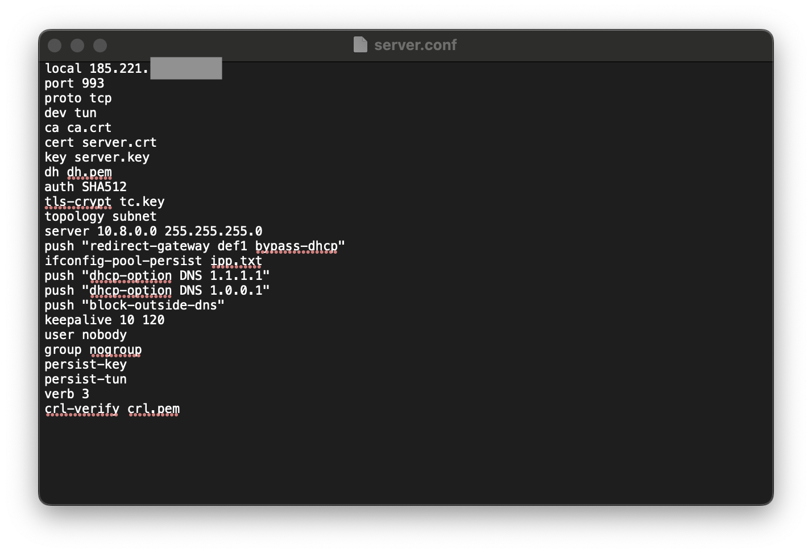{#fig-server-conf fig-align="center" width="100%"}

После генерации всех необходимых файлов директория openvpn имеет следующую структуру и наполнение (@fig-opnvpn_directory).

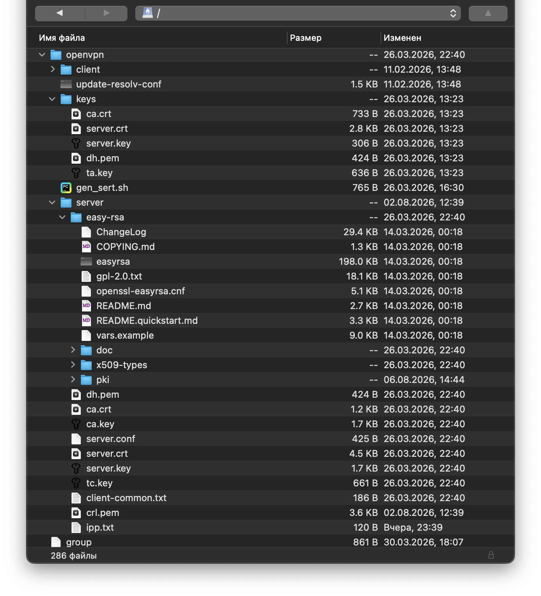{#fig-opnvpn_directory fig-align="center" width="100%"}

Исходя из наполнения директории можно выделить перечень важных файлов и поддиректорий:

- server.conf - основной конфигурационный файл, определяет как сервер принимает подключения, по каким правилам шифрует трафик и какую сеть выделяет клиентам. Содержимое показано ранее (см. @fig-server-conf);
- ca.crt - корневой сертификат удостоверяющего центра;
- server.crt - сертификат сервера, содержит его публичный ключ и подтверждение подлинности от удостоверяющего центра;
- server.key - закрытый ключ сервера;
- dh.pem - содержит параметры алгоритма Диффи-Хеллмана;
- ta.key и tc.key - предназначены для дополнительного шифрования;
- crl.pem - список отозванных сертификатов;
- ipp.txt - Файл пула IP-адресов. Сервер сохраняет в нем связку между идентификаторами клиентов и выданными ip-адресами, чтобы при переподключении выдавать пользователю тот же IP;

После настройки инструмента производится проверка статуса работы (@fig-opnvpn_status)

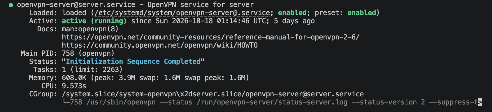{#fig-opnvpn_status fig-align="center" width="100%"}

Так как подключаться к виртуальной частной сети могут несколько пользователей, то необходимо разделить их трафик для корректного анализа, с этой целью применяется инструмент incrontab и лог-файл status-server.log.

- incrontab - демон, запускающий программы по событиям файловой системы;
- status-server.log - журнал событий, содержащий статистику подключенных клиентов, которая обновляется раз в минуту, данный лог-файл содержит информацию о идентификаторе клиента, его ip-адрес (@fig-status-server-log).

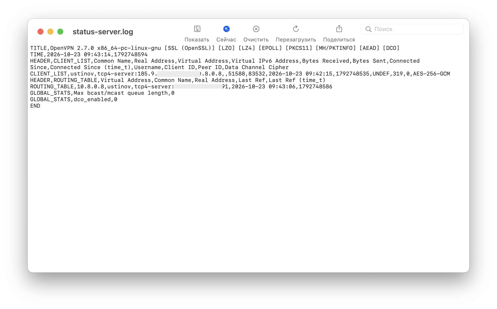{#fig-status-server-log fig-align="center" width="100%"}

На языке программирования Python был разработан скрипт, выполняющий парсинг status-server.log и запись сведений о VPN-пользователях в базу данных SQLite. Выполнение данного скрипта инициируется при изменении файла status-server.log, данное событие отслеживается инструментом incrontab. Логика работы скрипта следующая:

- Если в базе данных для пользователя с соответствующим идентификатором отсутствует информация об его IP-адресе, производится его добавление;
- Если в базе данных для пользователя с соответствующим идентификатором IP-адрес присутствует и совпадает с тем, что расположен в status-server.log, то обновление или добавление новой информации в соответствующую таблицу базы даных не выполняется;

Код скрипта представлен в @sec-status-server-script

### Настройка анализатора сетевого трафика Zeek

Для генерации подробных журналов событий о сетевых соединениях используется инструмент Zeek. По умолчанию пакет инструмента не включен в репозиторий Ubuntu по умолчанию, поэтому необходимо добавить репозиторий в APT. После установки и добавление Zeek в системную переменную производится проверка корректности установки (@fig-zeek-ver).

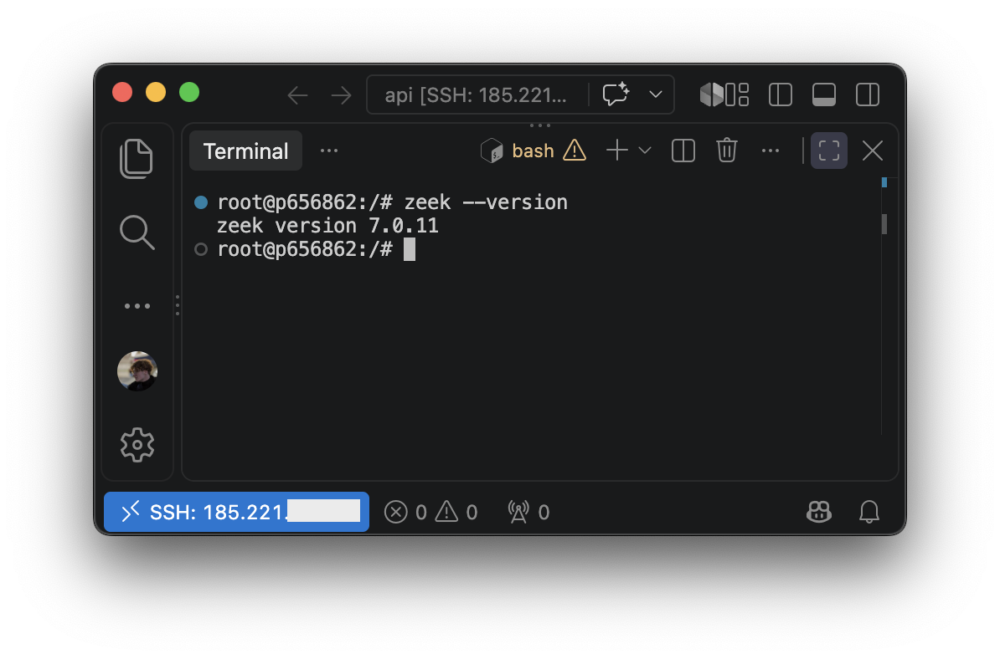{#fig-zeek-ver fig-align="center" width="100%"}

По-умолчанию анализатор просматривает сетевой трафик, проходящий через сетевой интерфейс eth0, однако клиенты подключаются к tun0, поэтому необходимо настроить zeek на прослушивание пакетов пользователей виртуальной частной сети OpenVPN. Для такой настройки необходимо обратиться к файлу node.cfg, который является основным конфигурационным файлом, в нем необходимо указать нужный интерфейс (@fig-node-cfg).

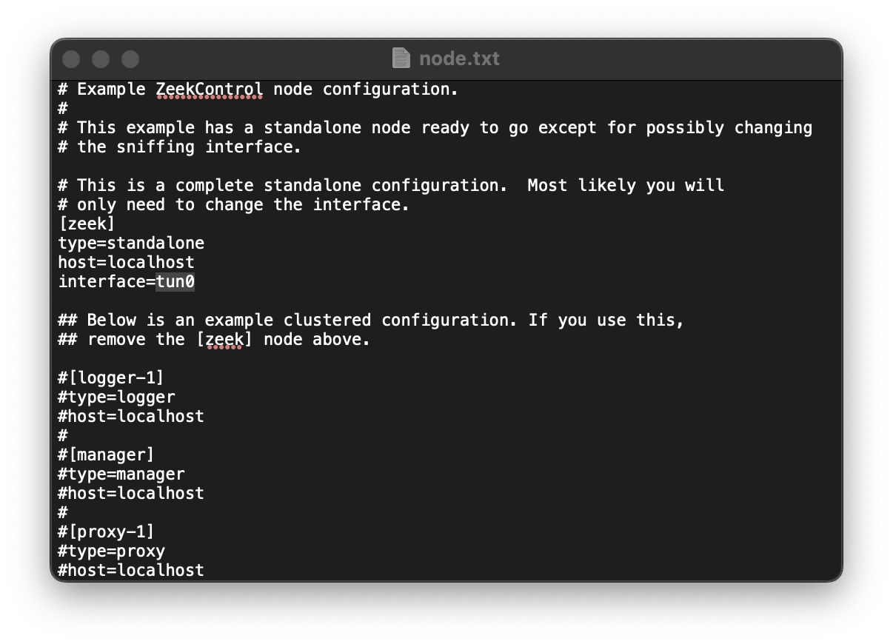{#fig-node-cfg fig-align="center" width="100%"}

Также следует провести конфигурацию взаимодействия анализатора с базой данных SQLite. Так как инструмент Zeek позволяет создавать большое количество разнообразных журналов событий, то возникает проблема нагрузки базы данных информацией из неиспользуемых лог-файлов, создаваемых средством. Таким образом, был написан скрипт zeekDb, позволяющий сохранять данные из следующих источников: conn.log, dns.log, ssl.log, intel.log. На рисунке ниже показан созданный код (@fig-zeekDb).

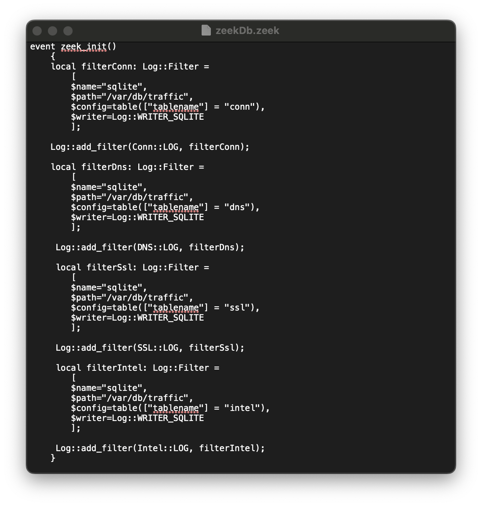{#fig-zeekDb fig-align="center" width="100%"}

Функция zeek_init выполняется один раз при старте Zeek. Внутри нее скрипт создает 4 фильтра, которые перехватывают системные логи и направляют их в базу данных. Для каждого фильтра заданы одинаковые параметры:

- \$writer=Log::WRITER_SQLITE - указывает анализатору использовать модуль записи в SQLite;

- \$path="путь к базе данных" - указывает путь к файлу базы данных.

Соответственно для каждого из вышеупомянутых лог-файлов создается отдельное правило, для их применения используются функции Log::add_filter.

Для подключения самописных скриптов и внешних плагинов в Zeek, необходимо внести изменения в главный пользовательский конфигурационный файл local.zeek (@fig-local-zeek).

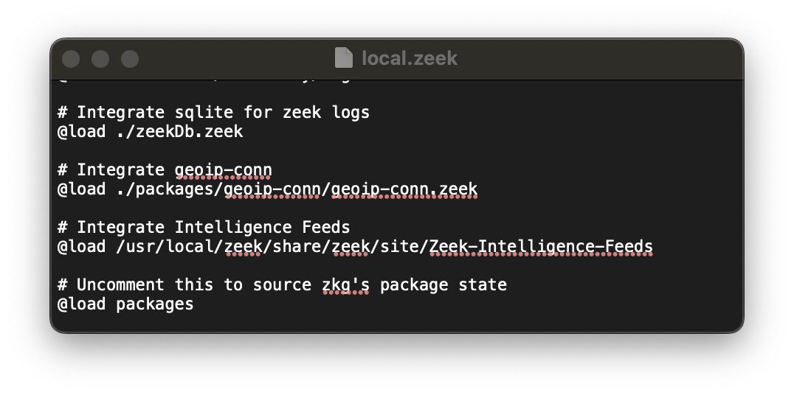{#fig-local-zeek fig-align="center" width="100%"}

Для установки пользовательского плагина geoip-conn используется стандартный менеджер пакетов Zeek. После успешной загрузки и сборки необходимо добавить данное расширение в файл local.zeek (@fig-local-zeek).

Также имеется расширение zeek-intelligence-feeds, в отличие от предыдущего, оно будет устанавливаться из репозитория системы контроля версий GitHub путем клонирования. После успешного переноса файлов плагина на сервер производится добавление данного подключаемого модуля в настроечный файл local.zeek (@fig-local-zeek). Стоит обратить внимание на содержимое склонированного репозитория, в нем содержатся перечни известных индикаторов компрометации, поскольку данные списки изменяются несколько раз в день, то создан скрипт zeek_update.sh (@fig-zeek-update-sh).

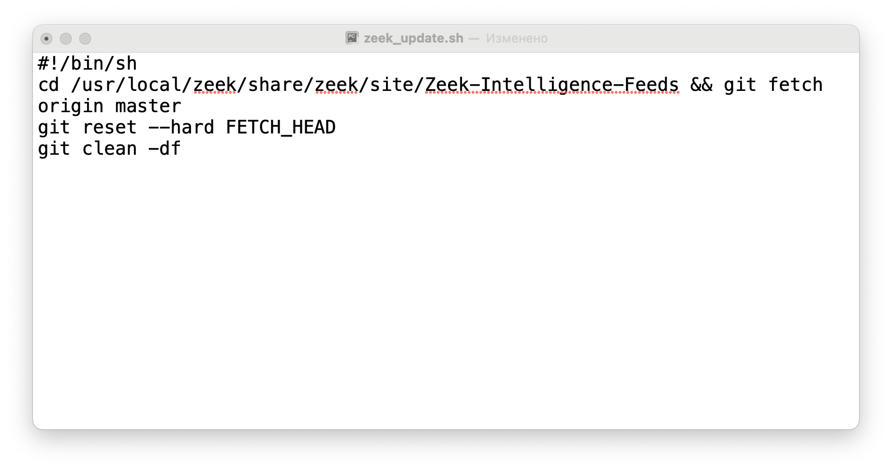{#fig-zeek-update-sh fig-align="center"}

Данный код принудительно обновляет базу индикаторов компрометации до самой актуальной версии из репозитория. Чтобы обеспечить выполнение скрипта 1 раз в 24 часа необходимо добавить задачу в планировщик cron (@fig-zeek-update-cron).

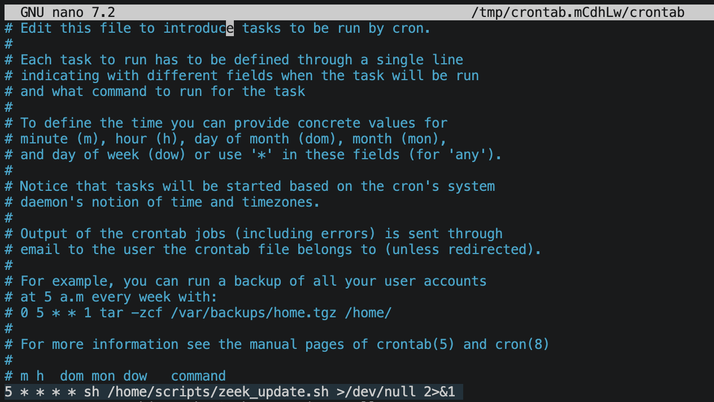{#fig-zeek-update-cron fig-align="center"}

В качестве проверки на успешную установку производится запуск zeek и проверка его статуса (@fig-zeek-start).

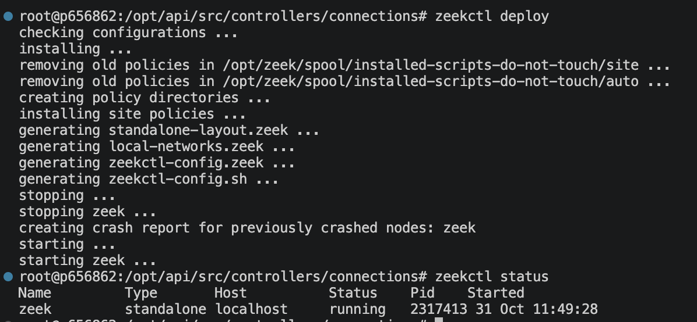{#fig-zeek-start fig-align="center"}

При успешной конфигурации плагинов в базе данных SQLite должны появится записи журналов событий, в conn информация о геолокации и в intel данные о подозрительных сетевых пакетах (@bd-conn-intel-start).

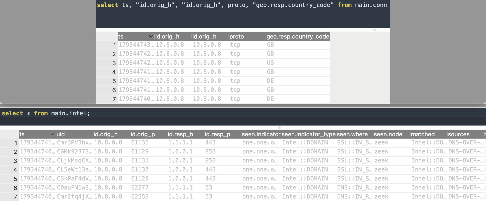{#bd-conn-intel-start fig-align="center"}

На рисунке выше видно, что при подключении клиента локальной частной сети с ip-адресом 10.8.0.8 в базе данных отображается информация из журналов событий, также в таблице conn добавлена информация о геолокации, что свидетельствует о работе geoip-conn. Помимо этого стоит обратить внимание на intel, в котором имеются записи о подозрительных подключениях, данный факт говорит о работе расширения zeek-intelligence-feeds.

## Конфигурация модуля хранения данных

В базе данных созданы 12 таблиц, ниже производится описание каждой из них.

Хранение базовой информации профиля пользователя вирутальной частной сети производится в vpn_users, данная таблица содержит следующие поля:

- id (первичный ключ, целочисленное значение) - индивидуальный идентификатор пользователя, присваивается клиенту в момент регистрации;

- ip_addr (первичный ключ, строковое значение) - ip-адрес, выданный пользователю регистрации;

- username (строковое значение) - придуманное клиентом имя, которое отображается в системе;

- hash_password (строковое значение) - захешированный пароль пользователя, благодаря которому клиент может входить в личный кабинет;

- role (строковое значение) - роль клиента в системе: администратор или узел;

- short_code (целочисленное значение) - короткий пин-код для быстрого входа в личный кабинет;

В разрабатываемой системе предусмотрен функционал добавления черных списков стран, ввиду этого создана таблица block_countries. Ниже представлены ее поля:

- id (первичный ключ, целочисленное значение) - индивидуальный идентификатор черного списка стран, выдается автоматически при создании;

- clientId (внешний ключ, целочисленные значение) - индивидуальный идентификатор пользователя виртуальной частной сети, связывает таблицу с vpn_users;

- countries_codes (строкое значение) - код страны.

Также стоит обратить внимание на таблицу block_domains, в которой описываются домены, добавленные в черный список, ниже представлены ее свойства:

- id (первичный ключ, целочисленное значение) - индивидуальный иденитификатор черного списка доменов, выдается автоматически при создании;

- clientId (внешний ключ, целочисленное значение) - индивидуальный идентификатор пользователя виртуальной частной сети, связывает таблицу с vpn_users;

- domains (строковое значение) - наименование домена.

В системе реализована возможность просмотра информации о сетевом трафике пользователя с ролью "узел" клиентом "администратор", поэтому создана таблица node_depends, содержащая информацию о связях между членами сети. Ниже представлено описание свойств:

- id (первичный ключ, целочисленное значение) - индивидуальный идентификатор связи между пользователями, автоматически формируется при регистрации новой зависимости;

- node_id (внешний ключ, целочисленное значение) - индивидуальный идентификатор клиента с ролью "узел";

- admin_id (внешний ключ, целочисленное значение) - индивидуальный идентификатор пользоваетеля с ролью "администратор".

Для информирования и оповещения пользователя о событиях в системе, разработана таблица notifications, в которой содержатся уведомления для конкретного клиента. Ниже описаны свойства:

- id (первичный ключ, целочисленное значение) - индивидуальный идентификатор уведомления, формируется при регистрации нового сообщения;

- client_id (внешний ключ, целочисленное значение) - индивидуальный идентификатор клиента, которому адресовано конкретное извещение, необходим для связи с таблицой vpn_users;

- type (строковое значение) - тип уведомления;

- payload (строковое значение) - текст сообщения;

- is_read (целочисленное значение) - флаг прочтения уведомления, где 0 - не просмотрено, 1 - прочтено;

Хранение информации о метаданных зашифрованного соединения производится в таблице ssl, которая содержит следующие поля:

- ts (дробное значение) - временная метка (timestamp) события;
- uid (первичный ключ, строковое значение) - уникальный идентификатор соединения;
- id.orig_h (внешний ключ, строковое значение, не null) - IP-адрес инициатора (клиента) соединения, позволяет установить связь с таблицей vpn_users;
- id.orig_p (целочисленное значение) - порт инициатора соединения;
- id.resp_h (строковое значение) - IP-адрес отвечающего узла (сервера);
- id.resp_p (целочисленное значение) - порт отвечающего узла;
- version (строковое значение) - версия протокола;
- cipher (строковое значение) - используемый набор шифров;
- curve (строковое значение) - используемая эллиптическая кривая;
- server_name (строковое значение) - имя сервера;
- resumed (логическое значение) - флаг возобновления предыдущей сессии;
- last_alert (строковое значение) - последнее сообщение об ошибке в сессии;
- next_protocol (строковое значение) - согласованный протокол прикладного уровня;
- established (логическое значение) - флаг успешного установления SSL-соединения;
- ssl_history (строковое значение) - история состояний SSL-соединения;
- cert_chain_fps (строковое значение) - отпечатки цепочки сертификатов сервера;
- client_cert_chain_fps (строковое значение) - отпечатки цепочки сертификатов клиента;
- subject (строковое значение) - субъект сертификата сервера;
- issuer (строковое значение) - издатель сертификата сервера;
- client_subject (строковое значение) - субъект сертификата клиента;
- client_issuer (строковое значение) - издатель сертификата клиента;
- sni_matches_cert (логическое значение) - флаг соответствия имени сервера заявленному в сертификате;
- validation_status (строковое значение) - результат проверки валидности сертификата.

Информация из журнала событий conn.log анализатор сетевого трафика zeek хранится в соответствующей таблице conn, описание полей представлено ниже:

- ts (дробное значение) - временная метка начала соединения;
- uid (первичный ключ, строковое значение) - уникальный идентификатор сетевого соединения;
- id.orig_h (внешний ключ, строковое значение) - IP-адрес инициатора соединения, также необходим для связи с таблицей vpn_users;
- id.orig_p (целочисленное значение) - порт инициатора соединения;
- id.resp_h (строковое значение) - IP-адрес отвечающего узла;
- id.resp_p (целочисленное значение) - порт отвечающего узла;
- proto (строковое значение) - транспортный протокол;
- service (строковое значение) - идентифицированный протокол прикладного уровня;
- duration (дробное значение) - длительность соединения в секундах;
- orig_bytes (целочисленное значение) - количество байт полезной нагрузки, отправленных инициатором;
- resp_bytes (целочисленное значение) - количество байт полезной нагрузки, отправленных отвечающим узлом;
- conn_state (строковое значение) - статус состояния соединения;
- local_orig (логическое значение) - флаг принадлежности инициатора к локальной сети;
- local_resp (логическое значение) - флаг принадлежности отвечающего узла к локальной сети;
- missed_bytes (целочисленное значение) - количество потерянных в соединении байт;
- history (строковое значение) - история состояний соединения в виде символьных кодов;
- orig_pkts (целочисленное значение) - количество пакетов от инициатора;
- orig_ip_bytes (целочисленное значение) - общий объем IP-трафика (в байтах) от инициатора;
- resp_pkts (целочисленное значение) - количество пакетов от отвечающего узла;
- resp_ip_bytes (целочисленное значение) - общий объем IP-трафика (в байтах) от отвечающего узла;
- tunnel_parents (строковое значение) - идентификаторы туннелей, внутри которых инкапсулировано данное соединение;
- geo.orig.\* и geo.resp.\* (строковые, целочисленные и дробные значения) - набор полей геопозиционирования (страна, регион, город, координаты) и данных автономных систем (название организации) для инициатора и отвечающего узла соответственно.

Данные из лог-файла dns, генерируемый инструментом zeek, сохраняются в одноименной таблице базы данных:

- ts (дробное значение) - временная метка DNS-запроса;
- uid (первичный ключ, строковое значение) - уникальный идентификатор сетевого соединения;
- id.orig_h (внешний ключ, строковое значение) - IP-адрес клиента, используется для связи с таблицей vpn_users;
- id.orig_p (целочисленное значение) - порт клиента;
- id.resp_h (строковое значение) - IP-адрес DNS-сервера;
- id.resp_p (целочисленное значение) - порт DNS-сервера;
- proto (строковое значение) - транспортный протокол;
- trans_id (целочисленное значение) - идентификатор транзакции DNS;
- rtt (дробное значение) - время приема-передачи;
- query (строковое значение) - доменное имя, о котором запрашивается информация;
- qclass (целочисленное значение) - класс запроса;
- qclass_name (строковое значение) - строковое обозначение класса;
- qtype (целочисленное значение) - тип запроса;
- qtype_name (строковое значение) - строковое обозначение типа запроса;
- rcode (целочисленное значение) - код ответа сервера;
- rcode_name (строковое значение) - строковое обозначение кода ответа;
- AA (логическое значение) - флаг авторитетного ответа;
- TC (логическое значение) - флаг усеченного сообщения ;
- RD (логическое значение) - флаг запроса рекурсии;
- RA (логическое значение) - флаг доступности рекурсии;
- Z (целочисленное значение) - зарезервированное поле;
- answers (строковое значение) - полученные ответы на запрос;
- TTLs (строковое значение) - время жизни записей;
- rejected (логическое значение) - флаг отклонения DNS-запроса сервером.

Для хранения событий обнаружения индикаторов компрометации из лог-файла intel, сформирована одноименная таблица со следующими свойствами:

- ts (дробное значение) - временная метка обнаружения индикатора;
- uid (первичный ключ, строковое значение) - уникальный идентификатор соединения, в котором найдено совпадение;
- id.orig_h (внешний ключ, строковое значение) - исходный IP-адрес, создает связь с таблицей vpn_users;
- id.orig_p (целочисленное значение) - порт источника;
- id.resp_h (строковое значение) - целевой IP-адрес;
- id.resp_p (целочисленное значение) - целевой порт;
- seen.indicator (строковое значение) - зафиксированный индикатор компрометации;
- seen.indicator_type (строковое значение) - тип индикатора;
- seen.where (строковое значение) - контекст обнаружения;
- seen.node (строковое значение) - имя узла, зафиксировавшего совпадение;
- matched (строковое значение) - списки или категории, с которыми совпал индикатор;
- sources (строковое значение) - источники данных киберразведки;
- fuid (строковое значение) - уникальный идентификатор файла, если индикатор связан с файлом;
- file_mime_type (строковое значение) - MIME-тип обнаруженного файла;
- file_desc (строковое значение) - описание файла;
- checked (логическое значение) - флаг завершения проверки индикатора;
- cif.tags (строковое значение) - теги из системы Collective Intelligence Framework (далее CIF);
- cif.confidence (дробное значение) - уровень достоверности индикатора по данным CIF;
- cif.source (строковое значение) - источник данных CIF;
- cif.description (строковое значение) - описание угрозы из базы CIF;
- cif.firstseen (строковое значение) - дата первого обнаружения индикатора;
- cif.lastseen (строковое значение) - дата последнего обнаружения индикатора.

Модуль поведенческого профилирования при детектировании подозрительной активности клиента формирует событие, поэтому была сформирована таблица behavioral_alerts для хранения этих уведомлений. Ниже представлены ее поля:

- id (первичный ключ, целочисленное значение) - индивидуальный идентификатор уведомления;

- user_id (внешний ключ, целочисленное значение) - индивидуальный идентификатор клиента, необходим для связи с таблицей vpn_users;

- timestamp (значение типа timestamp) - дата и время создания сообщения;

- weekday (целочисленное значение) - день недели, представлен в виде значения от 0 до 6, где 0 - понедельник, 6 - воскресенье;

- slot (целочисленное значение) - часть дня, пиредставлен в виде значения от 0 до 3, где 0 - утро, 3 - ночь;

- anomaly_score (дробное значение) - показатель аномалии от 0 до 1, где 0 - сетевой трафик полностью соответствует поведению пользователя, 1 - имеются серьезные отклонения;

- details (строковое значение) - текст сообщения.

Для хранения информации о пользователе сети, которая в дальнейшем будет использована в обучении модели машинного обучения, создана таблица user_window_stats:

- id (первичный ключ, целочисленное значение) - индивидуальный идентификатор окна сбора информации;

- user_id (внешний ключ, целочисленное значение) - индивидуальный идентификатор клиента сети, необходим для связи с таблицей vpn_users;

- window_start (значение типа timestamp) - дата и время начала сбора данных о трафике;

- weekday (целочисленное значение) - день недели, представлен в виде значения от 0 до 6, где 0 - понедельник, 6 - воскресенье;

- slot (целочисленное значение) - часть дня, пиредставлен в виде значения от 0 до 3, где 0 - утро, 3 - ночь;

- total_conns (целочисленное значение) - общее число подключений;

- unique_dst_ips (целочисленное значение) - количество уникальных ip-адресов назначений;

- unique_dst_ports (целочисленное значение) - количество уникальных портов назначений;

- orig_bytes (целочисленное значение) - сумма полученных байт;

- resp_bytes (целочисленное значение) - сумма отправленных байт;

- avg_duration (дробное значение) - среднее время соединения;

- conns_per_sec (дробное значение) - количество соединений в секунду;

- created_at (значение типа timestamp) - дата и время создания записи;

В результате обучения модели машинного обучения создается файл с ее моделью, для сохранения информации по этому элементу создана таблица model_metadata:

- id (первичный ключ, целочисленное значение) - индивидуальный идентификатор версии модели;

- user_id (внешний ключ, целочисленное значение) - индивидуальный идентификатор клиента сети, необходим для связи с таблицей vpn_users;

- model_path (строковое значение) - путь в файловой системе сервера до обученной модели под конкретного пользователя;

- scaler_path (строковое значение) - путь к файлу скалера;

- training_date (timestamp значение) - дата последнего обучения модели машинного обучения клиента.

Для обеспечения корректного хранения данных, взаимодействие между таблицами реализовано следующим образом:

- Таблица vpn_users соединена с model_metadata связью типа «один-ко-многим» (внешний ключ user_id ссылается на первичный ключ id). Такая связь обусловлена сохранением истории: у одного клиента с течением времени может формироваться и сохраняться несколько версий обученных моделей машинного обучения;

- Таблица vpn_users соединена с user_window_stats связью типа «один-ко-многим» (внешний ключ user_id ссылается на первичный ключ id). Данный тип связи выбран, поскольку в процессе сбора статистики для одного пользователя генерируется множество срезов сетевого трафика;

- Таблица vpn_users соединена с behavioral_alerts связью типа «один-ко-многим» (внешний ключ user_id ссылается на первичный ключ id). Это необходимо из-за того, что модуль профилирования может фиксировать несколько событий с подозрительным поведением для одного клиента;

- Таблица vpn_users соединена с notifications связью типа «один-ко-многим» (внешний ключ client_id ссылается на первичный ключ id). Связь гарантирует, что одному пользователю может быть адресовано неограниченное количество системных уведомлений с возможностью индивидуального отслеживания статуса их прочтения;

- Таблица vpn_users соединена с node_depends связью типа «один-ко-многим», (внешние ключи node_id и admin_id ссылаются на первичный ключ id). Такая структура обусловлена тем, что один администратор может мониторить множество узлов, а один узел может контролироваться несколькими администраторами;

- Таблица vpn_users соединена с block_countries связью типа «один-ко-многим» (внешний ключ clientId ссылается на первичный ключ id). У одного пользователя может быть несколько стран в черном списке;

- Таблица vpn_users соединена с block_domains связью типа «один-ко-многим» (внешний ключ clientId ссылается на первичный ключ id). Аналогично предыдущей, эта связь позволяет задавать множество запрещенных доменных имен для одного конкретного клиента;

- Таблица vpn_users соединена с conn связью типа «один-ко-многим» (внешний ключ id.orig_h ссылается на первичный ключ ip_addr). Один клиент генерирует тысячи сетевых соединений;

- Таблица vpn_users соединена с dns связью типа «один-ко-многим» (внешний ключ id.orig_h ссылается на первичный ключ ip_addr). В рамках работы одного клиента отправляется множество DNS-запросов;

- Таблица vpn_users соединена с ssl связью типа «один-ко-многим» (внешний ключ id.orig_h ссылается на первичный ключ ip_addr). Один пользователь инициирует множество ssl-сессий;

- Таблица vpn_users соединена с intel связью типа «один-ко-многим» (внешний ключ id.orig_h ссылается на первичный ключ ip_addr). Эта связь обусловлена тем, что в трафике одного пользователя может быть зафиксировано множество сетевых соединений с обнаруженными индикаторами компрометации.

Исходя из описаний связей и таблиц базы данных, сформирована общая схема (@fig-db-scheme).

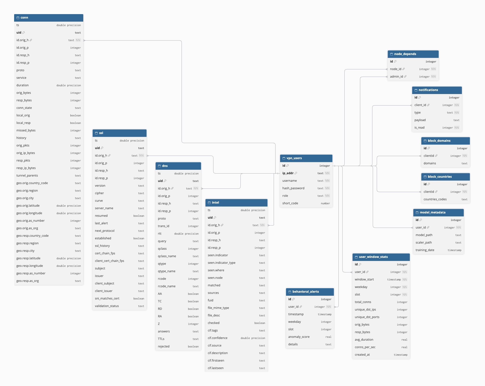{#fig-db-scheme fig-align="center"}

## Создание модуля поведенческого профилирования

Модуль поведенческого профилирования состоит из пяти взаимосвязанных скриптов, которые в совокупности образуют полный цикл обработки данных, начиная от сбора статистики, заканчивая машинным обучением и выявлением аномалий в реальном времени. Ниже приведена таблица с описанием каждого файла (@tbl-ml-funcs).

+--------------------------------------+---------------------------------------------------------------------------------------------------------------------------+--------------------------------------------------------------------------------------------------------------------------------------------------------------------------------------------------------------------------------------------------------------------------------------------------------------------------------------------------------------------------------+-----------------------------------------------------------------------------------------------------------------------------------------------------------------+
| Наименование                         | Назначение                                                                                                                | Выполняемые функции                                                                                                                                                                                                                                                                                                                                                            | Используемые библиотеки                                                                                                                                         |
+:=====================================+:==========================================================================================================================+:===============================================================================================================================================================================================================================================================================================================================================================================+:================================================================================================================================================================+
| constants.py (см. @sec-ml-constants) | Хранение глобальных параметров системы                                                                                    | Централизованное хранение пути к базе данных SQLite, позволяет легко изменять расположение источника без необходимости редактирования каждого скрипта по отдельности                                                                                                                                                                                                           | Не использует сторонних библиотек                                                                                                                               |
+--------------------------------------+---------------------------------------------------------------------------------------------------------------------------+--------------------------------------------------------------------------------------------------------------------------------------------------------------------------------------------------------------------------------------------------------------------------------------------------------------------------------------------------------------------------------+-----------------------------------------------------------------------------------------------------------------------------------------------------------------+
| collector.py (см. @sec-ml-collector) | Сбор статистики, формирование исторических данных для обучения модели машинного обучения                                  | Функция collector определяет текущее время и вычисляет временное окно за последние 6 часов.                                                                                                                                                                                                                                                                                    | sqlite3 - для подключения к базе данных и выполнения SQL-запросов                                                                                               |
|                                      |                                                                                                                           |                                                                                                                                                                                                                                                                                                                                                                                |                                                                                                                                                                 |
|                                      |                                                                                                                           | Запрашивает из базы данных список пользователей VPN, для которых еще не была обучена поведенческая модель.                                                                                                                                                                                                                                                                     | time и datetime - для работы с временными метками, вычисления 6-часового интервала и извлечения текущего дня недели и часа.                                     |
|                                      |                                                                                                                           |                                                                                                                                                                                                                                                                                                                                                                                |                                                                                                                                                                 |
|                                      |                                                                                                                           | Для каждого такого пользователя агрегитрует сетевой трафик из таблицы conn и dns за последние 6 часов.                                                                                                                                                                                                                                                                         |                                                                                                                                                                 |
|                                      |                                                                                                                           |                                                                                                                                                                                                                                                                                                                                                                                |                                                                                                                                                                 |
|                                      |                                                                                                                           | Сохраняет агрегированную статистику в таблицу user_window_stats для последующего использования при обучении                                                                                                                                                                                                                                                                    |                                                                                                                                                                 |
+--------------------------------------+---------------------------------------------------------------------------------------------------------------------------+--------------------------------------------------------------------------------------------------------------------------------------------------------------------------------------------------------------------------------------------------------------------------------------------------------------------------------------------------------------------------------+-----------------------------------------------------------------------------------------------------------------------------------------------------------------+
| helpers.py (см. @sec-ml-helpers)     | Вспомогательный модуль. Преобразует сырую статистику в нормализованный вектор признаков для алгоритмов машинного обучения | Функция get_user_history_rates извлекает исторические данные пользователя из таблицы user_window_stats.                                                                                                                                                                                                                                                                        | sqlite3 - для подключения к базе данных и выполнения SQL-запросов                                                                                               |
|                                      |                                                                                                                           |                                                                                                                                                                                                                                                                                                                                                                                |                                                                                                                                                                 |
|                                      |                                                                                                                           | Переводит абсолютные значения в скорость (например, количество событий в секунду).                                                                                                                                                                                                                                                                                             | pandas - для загрузки результатов SQL-запроса в датафрейм                                                                                                       |
|                                      |                                                                                                                           |                                                                                                                                                                                                                                                                                                                                                                                |                                                                                                                                                                 |
|                                      |                                                                                                                           | Формирует цикличеаские признаки.                                                                                                                                                                                                                                                                                                                                               | numpy - для вычисления значений тригонометрических функций                                                                                                      |
|                                      |                                                                                                                           |                                                                                                                                                                                                                                                                                                                                                                                |                                                                                                                                                                 |
|                                      |                                                                                                                           | Возвращает готовый массив признаков                                                                                                                                                                                                                                                                                                                                            |                                                                                                                                                                 |
+--------------------------------------+---------------------------------------------------------------------------------------------------------------------------+--------------------------------------------------------------------------------------------------------------------------------------------------------------------------------------------------------------------------------------------------------------------------------------------------------------------------------------------------------------------------------+-----------------------------------------------------------------------------------------------------------------------------------------------------------------+
| trainer.py (см. @sec-ml-trainer)     | Создает индивидуальную модель машинного обучения для каждого пользователя                                                 | Функция user_train находит всех активных пользователей и запускает для них процес обучения                                                                                                                                                                                                                                                                                     | os - для создания директории сохранения моделей                                                                                                                 |
|                                      |                                                                                                                           |                                                                                                                                                                                                                                                                                                                                                                                |                                                                                                                                                                 |
|                                      |                                                                                                                           | Функция train_user_model запрашивает подготовленные исторические данные, используя модуль helpers.py                                                                                                                                                                                                                                                                           | sqlite3 - для запросов к базе данных и сохроанения путей к моделям                                                                                              |
|                                      |                                                                                                                           |                                                                                                                                                                                                                                                                                                                                                                                |                                                                                                                                                                 |
|                                      |                                                                                                                           | Обучает модель изолирующий лес                                                                                                                                                                                                                                                                                                                                                 | sklearn.ensemble.IsolationForest - основной алгоритм машинного обучения для поиска аномалий                                                                     |
|                                      |                                                                                                                           |                                                                                                                                                                                                                                                                                                                                                                                |                                                                                                                                                                 |
|                                      |                                                                                                                           | Сохраняет обученную модуль и скалер в файловую систему сервера                                                                                                                                                                                                                                                                                                                 | sklearn.preprocessing.StandardScaler - для стандартизации входных данных                                                                                        |
|                                      |                                                                                                                           |                                                                                                                                                                                                                                                                                                                                                                                |                                                                                                                                                                 |
|                                      |                                                                                                                           | Записывает путь к сохраненной модели в таблицу model_metadata                                                                                                                                                                                                                                                                                                                  | joblib - для сохранения файла обученной модели и скейлера                                                                                                       |
+--------------------------------------+---------------------------------------------------------------------------------------------------------------------------+--------------------------------------------------------------------------------------------------------------------------------------------------------------------------------------------------------------------------------------------------------------------------------------------------------------------------------------------------------------------------------+-----------------------------------------------------------------------------------------------------------------------------------------------------------------+
| checker.py (см см. @sec-ml-checker)  | В режиме реального времени проверяет текущий трафик пользователей на предмет отклонений от их профиля                     | Функция user_check определяет список активных пользователей за последние 5 минут                                                                                                                                                                                                                                                                                               | sqlite3 - для запросов к базе данных                                                                                                                            |
|                                      |                                                                                                                           |                                                                                                                                                                                                                                                                                                                                                                                |                                                                                                                                                                 |
|                                      |                                                                                                                           | Функция checker собирает статистику сетевой активности конкретного пользователя за последние 5 минут за таблиц conn и dns                                                                                                                                                                                                                                                      | pandas и numpy - для трансформации сырых признаков в массивы, пригодные для подачи на вход модели машинного обучения, а также для расчета циклических признаков |
|                                      |                                                                                                                           |                                                                                                                                                                                                                                                                                                                                                                                |                                                                                                                                                                 |
|                                      |                                                                                                                           | Расчитывает текущие сетевые параметры трафика                                                                                                                                                                                                                                                                                                                                  | joblib - для загрузки в память обученной модели                                                                                                                 |
|                                      |                                                                                                                           |                                                                                                                                                                                                                                                                                                                                                                                |                                                                                                                                                                 |
|                                      |                                                                                                                           | Загружает ранее обученную модель и скейлер из файла, путь к которому расположен в таблице model_metadata                                                                                                                                                                                                                                                                       | json - для упаковки подробной информации об инциденте в формат JSON.                                                                                            |
|                                      |                                                                                                                           |                                                                                                                                                                                                                                                                                                                                                                                |                                                                                                                                                                 |
|                                      |                                                                                                                           | Масштабирует новые данные и передает их в модель для предсказания                                                                                                                                                                                                                                                                                                              | datetime - для определения текущего времени, вычисления окна в 5 минут                                                                                          |
|                                      |                                                                                                                           |                                                                                                                                                                                                                                                                                                                                                                                |                                                                                                                                                                 |
|                                      |                                                                                                                           | Модель машинного обучения сопоставляет текущий трафик с профилем пользователя, возвращая значение от 1 до -1, где 1 - норма, а -1 - абсолютное отклонение. Программный порог со значением \<= -0.5 служит триггером для фиксации этого отрицательного ответа. При срабатывании условия система автоматически сохраняет предупреждение об инциденте в таблицу behavioral_alerts |                                                                                                                                                                 |
+--------------------------------------+---------------------------------------------------------------------------------------------------------------------------+--------------------------------------------------------------------------------------------------------------------------------------------------------------------------------------------------------------------------------------------------------------------------------------------------------------------------------------------------------------------------------+-----------------------------------------------------------------------------------------------------------------------------------------------------------------+

: Описание скриптов из модуля поведенческого профилирования {#tbl-ml-funcs}

## Формирование REST API

Данный модуль разрабатываемой системы необходим для взаимодействия пользователя с удаленным сервером путем отправки запросов на строгоопределенные конечные точки (endpoint-ы), которые обеспечивают выполнение требуемых операций и предоставляют доступ к сведениям из базы данных.

### Настройка Node.js

Установка среды разработки Node.js осуществляется через репозиторий операционной системы Linux Ubuntu. Каждому экземпляру Node принадлежит собственная версия npm - это стандратный менеджер пакетов, который входит в состав экосистемы Node.js, благодаря ему появляется возможность установки дополнительных модулей, необходимых для проекта. Для проверки корректности загрузки и настройки инструментов, в консоль выводятся их версии (@fig-node-npm-ver).

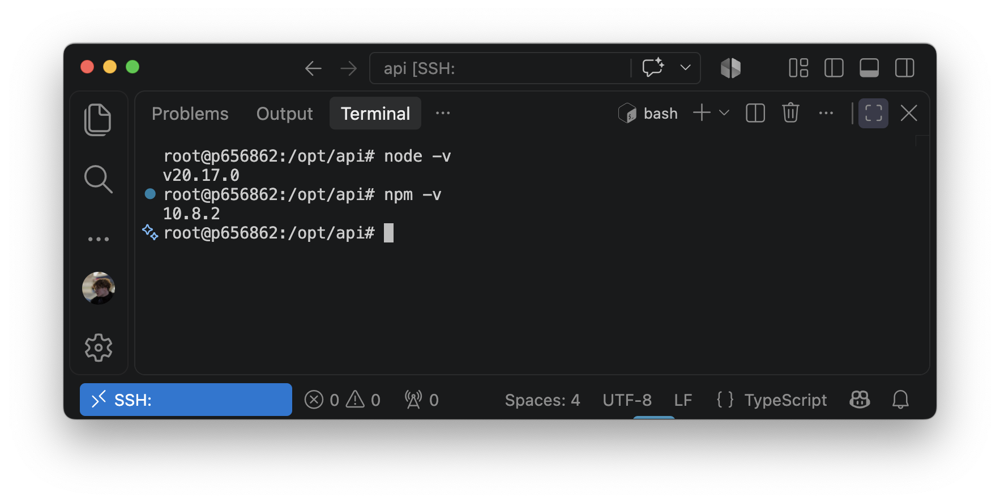{#fig-node-npm-ver fig-align="center"}

### Файловая организация подсистемы и программная реализация модуля

Файловая структура проекта представлена следующими директориями и конфигурационными файлами (@fig-api-directory-struct):

- node_modules - директория, содержащая все установленные соронние библиотеки и зависимости проекта, необходимые для корректного функционирования модуля;

- src - корневая папка исходного кода рарзрабатываемого серверного интерфейса. Директория разделена на подкаталоги:

  - controllers - модуль, содержащий контроллеры для обработки бизнес-логики входящих HTTP-запросов. Внутри реализовано логическое разделение на две подкатегории:

    - connections - содержит файлы, отвечающие за обработку данных, связанных с сетевой активностью пользователя;

    - user - содержит файлы, реализзующие логику ууправления учетными записями, процессами аутентификации, формированием персональных черных списков и отправкой уведомлений;

  - db - директория для взаимодействия с харнилищем данных, содержит методы для формирования запросов к базе данных;

  - middleware - папка для промежуточных обработчиков, в данной реализации включает один файл, который реализует логику проверки токенов доступа и авторизации клиентских запрсоов перед их передачей в контроллеры;

  - types - содержит файлы с описанием структур данных;

  - index.ts - точка входа. В нем происходит инициализация, подключение обработчиков и регистрация маршрутов;

  - vpnConf.ts - специализированный скрипт, отвечающий за генерацию или выдачу клиентского VPN-профиля для подключения устройства;

- package.json/package-lock.json - файлы платформы Node.js, содержащие метаданные проекта, перечень установленных зависимостей и скрипты для сборки и запуска приложения;

- tsconfig.json - файл конфигурации компилятора TypeScript;

- nodemon.json - конфигурационный файл утилиты nodemon, которая используется на этапе разработки для автоматического перезапуска сервера при внесении изменений в исходный код.

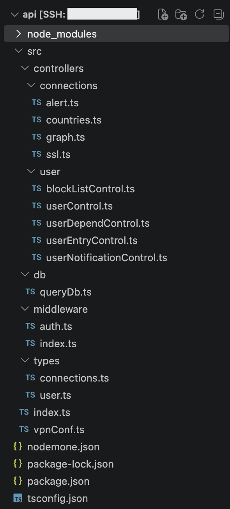{#fig-api-directory-struct fig-align="center"}

Для понимания внутренних механизмов обработки HTTP-запросов и взаимодействия с хранилищем необходимо детально рассмотреть программную реализацию ключевых компонентов системы. Анализ кодовой базы целесообразно проводить в соответствии с потоком выполнения: от инициализации и фильтрации запросов до отработки бизнес-логики в контроллерах.

Файл src/index.ts (см. @sec-api-index) выступает в роли точки входа приложения и отвечает за инициализацию веб-сервера, подключение промежуточных обработчиков и регистрацию маршрутов REST API. Программная реализация выполнена на базе фреймворка Express.js. Скрипт создает экземпляр приложения Express и назначает сетевой порт 3000. Все входящие запросы до передачи контроллерам последовательно проходят через глобальные промежуточные обработчики:

- checkAuth (см. @sec-api-checkAuth) - функция, извлекает переданный клиентом ключ из заголовка Authorization и передает его вспомогательной функции mainAuth (см. @sec-api-mainAuth), которая сравнивает хеш-сумму полученного ключа с эталонным значением секретной фразы. При несовпадении хешей обработка прерывается, и клиенту возвращается статус 401 с ошибкой авторизации;

- bodyParser - выполняет парсинг тела HTTP-запроса, преобразуя переданные клиентом данные в объект JSON;

Маршрутизация построена на обработке POST-запросов и логически разделена на 2 фукциональные подсистемы:

- Сетевая аналитика и выявление угроз (/traffic/connections/):

  - graph - вызывает контроллер для получения агрегированной информации об объемах потребляемого трафика;

  - ssl/top и countries/top - возвращают рейтинги наиболее востребованных веб-ресурсов и стран взаимодействия;

  - alert - извлекает данные о выявленных проблемных соединениях, сетевых аномалиях и подозрительной активности пользователя.

- Управление учетными записями и доступом (/traffic/users/):

  - Маршруты reg, login, shortcode, fastEntry реализуют махенизмы регистрации, классического входа по паролю и быстрой авторизации в мобильном приложении по короткому коду;

  - info - предоставляет данные пользователя;

  - download/config - инициирует загрузку клиентского профиля OpenVPN на мобильное устройство;

  - blockList/countries, blockList/domains передают параметры для добавления и получениях пользовательских правил блокировки конкретных доменов и стран;

  - deleteDepends, getDepends, confirmDepend, denyDepend отвечают за установку, просмотр и разрыв связей между узлом и администратором;

  - sendNotiffication, getNotiffications обеспечивают процесс отправки и получения системных уведомлений.

Файл src/db/queryDb.ts (см. @sec-api-queryDb) необходим для инкапсуляции логики подключения к базе данных и отправке в нее запросов.

Файл vpnConf.ts (см. @sec-api-vpnConf) необходим для автоматизации рутинного процесса создания конфигурационных файлов для безопаного подключения клиентов к серверу. При запросе скрипт обращается к утилите easy-rsa, которая генерирует сертификат. Затем программный код считывает общий базовый шаблон настроек OpenVPN-клиента, очищает его от лишних комментариев и добавляет сгенерированный ключ. Итоговый результат объединяется в единый готовый файл с расширением .ovpn и сохраняется в файловую систему сервера.

Файл src/controllers/user/userEntryControl.ts (см. @sec-api-userEntryControl) обрабатывает первичную регистрацию новых пользователей, сохраняя их данные в базу, и при успешном создании аккаунта автоматически инициирует выпуск персонального VPN-профиля. Для уже зарегистрированных клиентов склипт реализует проверку связки логина и пароля, а также предоставляет функционал настройки и использования короткого цифрового кода. Это позволяет реализовать механизм быстрого входа в мобильное приложение при последующих сессиях, избавляя пользователя от необходимости каждый раз вводить полный пароль.

Файл src/controllers/user/userDependControl.ts (см. @sec-api-userDependControl) управляет зависимостями между учетными записями в системе, а именно между управляемыми устройствами и их администраторами. Скрипт просматривает существующие соединения, а также обрабатывает логику их подтверждения, отклонения и удаления.

В файле src/controllers/user/userNotificationControl.ts (см. @sec-api-userNotificationControl) реализуется механизм отправки системных сообщений клиентам, а также предоставляет функционал для получения списка актуальных, не прочитанных уведомлений.

Файл src/controllers/user/userControl.ts (см. @sec-api-userControl) предоставляет клиенту функционал для скачивания VPN-конфигурации и получения базовой информации о пользователе.

Задача файла src/controllers/user/blockListControl.ts (см. @sec-api-blockListControl) заключается в управлении персональными черными списками для стран и доменных имен. Скрипт предоставляет функционал для сохранения, точечного обновления и получения списков ограничений, привязанных к конкретной учетной записи.

Файл src/controllers/connections/alert.ts (см. @sec-api-alert) отвечает за извлечение из базы данных и отправку клиенту информации о выявленных проблемных соединениях и сетевых аномалиях. Контроллер getAlerts обращается к таблице vpn_users для определения IP-ареса пользователя. Если адрес найден, он запрашивает из таблицы intel данные об угрозах, зафиксированных плагинов Zeek–Intelligence-Feeds. Дополнительно из таблицы behavioral_alerts извлекаются инциденты, зафиксированные модулем поведенческого профилирования на основе машинного обучения. Оба массива данных отправдяются в формате JSON.

Файл src/controllers/connections/countries.ts (см. @sec-api-countries) предоставляет статистику по странам, с которыми взаимодействовал клиент, формируя рейтинг по количеству соединений с ip-адресами из конкретного региона. Функция getCountriesTop определяет роль и IP-адрес клиента. В базе данных выполняется запрос к таблице conn, подсчитывающий количество соединений для каждой страны за указанный период времени. Скрипт также запрашивает актуальный список стран, которые расположены в черном списке и помечает в итоговом ответе те регионы, которые в нем находятся.

Файл src/controllers/connections/graph.ts (см. @sec-api-graph) реализует логику сбора данных об объемах входящего и исходящего сетевого трафика для их визуализации в виде графиков на стороне мобильного приложения. Скрипт выполняет SQL-запросы к таблице conn и возвращает объект, который содержит массив точек для графика.

Файл src/controllers/connections/ssl.ts (см. @sec-api-ssl) формирует рейтинг наиболее посещаемых пользователем веб-ресурсов. Контроллер getSslTop запрашивает из таблицы ssl информацию об установленных соединениях и подсчитывает количество обращений к каждому домену. Скрипт учитывает черный список доменов. В результате пользователю возвращается массив из 5 самых популярных ресурсов по обращению.
